# Using the Mrbr.Bastion configuration application

Verified on Windows on **27 October 2026** against the solution's Release build.

This guide covers the WinForms application **Mrbr.Bastion.Desktop**: editing settings with its PropertyGrid, creating signing keys, enrolling ledgers, configuring HTTPS and operators, saving/exporting settings, and running the local components.

The latest verification is in **Section 17**: a fresh deployment with retention enabled preserved pending blocks, continued signed audit history, delivered all **2,506 blocks** and verified the archives after compaction. It records both an initial capacity failure and a loss-free recovery run. Section 15 retains the earlier same-host feedback comparison.

**Section 16** describes the retention controls and their initial automated verification. Section 17 records their subsequent live configuration-app test and new screenshots. The [functionality and MVP assessment](FUNCTIONALITY-AND-MVP.md) separates implemented features from remaining and proposed work.

The recorded walkthrough used an isolated folder:

```text
E:\Dev\source\Mrbr.Bastion\tmp\configuration-guide-demo
```

The exact deployment text entered through the computer-use accessibility interface was `E:/Dev/source/Mrbr.Bastion/tmp/configuration-guide-demo`. Windows normalized saved filenames to backslashes. Substitute your own deployment directory for normal use.

## What was verified

Results below use these labels:

- **UI observed** — checked in the running application using the computer-use accessibility interface and keyboard commands; saved files were checked on disk.
- **User performed** — Windows approval, password entry or elevated app controls were handled directly by the user; resulting screenshots, database contents and HTTPS responses were independently checked where available.
- **Automated test** — exercised by the solution's configuration, cryptography, persistence, process-control, or WinForms tests.
- **Expected/manual** — instructions for provisioning or operating your deployment; the action was not performed in the recorded UI walkthrough.

The initial walkthrough in Sections 1–12 kept **Run Collector** and **Run Inventory** set to `False`, and all processes stopped. Section 13 records the separate local end-to-end test requested afterwards, including its observed results and any required Windows/user handoffs.

The WinForms screenshots are actual application views exported by **File → Save screenshot**. The computer-use screen-capture helper returned `FrameArrived timed out`, so the application's native WinForms PNG export was used. This captures the application window without unrelated desktop windows. Dashboard images use the browser's screenshot capture. The images were visually checked.

For Sections 1–12, mouse actions describe equivalent manual operations; automation used property value setters and keyboard shortcuts. The elevated controls in the end-to-end run were user performed. Browser navigation in Section 14 used the observed buttons and search field through computer use.

## 1. Open the application

| Action | Mouse/keyboard input | Result |
| --- | --- | --- |
| Build the solution | In Visual Studio, select the desired Debug/Release configuration and build the solution. | **Automated/build:** Release build completed with zero warnings and zero errors. |
| Choose the desktop launcher | Right-click **Mrbr.Bastion.Desktop** in Solution Explorer; left-click **Set as Startup Project**. | **Expected/manual:** F5 launches the configuration application. |
| Start | Press **F5**, or run the built `Mrbr.Bastion.Desktop.exe`. | **UI observed:** the control panel opened with six navigation sections, a PropertyGrid, command links, process states, and a log. |

The built Release executable is:

```text
E:\Dev\source\Mrbr.Bastion\Mrbr.Bastion.Desktop\bin\Release\net11.0-windows\Mrbr.Bastion.Desktop.exe
```

The default deployment directory is `%LOCALAPPDATA%\Mrbr.Bastion\default`. Merely opening the application does not start the receiver or either agent.

## 2. Choose the deployment directory and components

1. Left-click **Workspace**, or press **Ctrl+1**.
2. Left-click the value beside **Deployment Directory**. Press **F2** if needed, then **Ctrl+A**, type your folder, and press **Enter** to commit the edit. Its `[…]` editor can also select a folder.
3. Choose which components **Start selected** should run.

| Property | Walkthrough value | Meaning |
| --- | --- | --- |
| Deployment Directory | `E:/Dev/source/Mrbr.Bastion/tmp/configuration-guide-demo` | Base directory for relative configuration, database, key, and screenshot paths. |
| Run Receiver | `True` | Include the receiving/reporting service. |
| Run Collector | `False` | Kept stopped for the walkthrough. Set `True` for live process/file monitoring. |
| Run Inventory | `False` | Kept stopped for the walkthrough. Set `True` for software inventory and CVE evidence. |

**UI observed:** those values appeared in the grid and were preserved in the saved profile. All three process states remained `Stopped`.

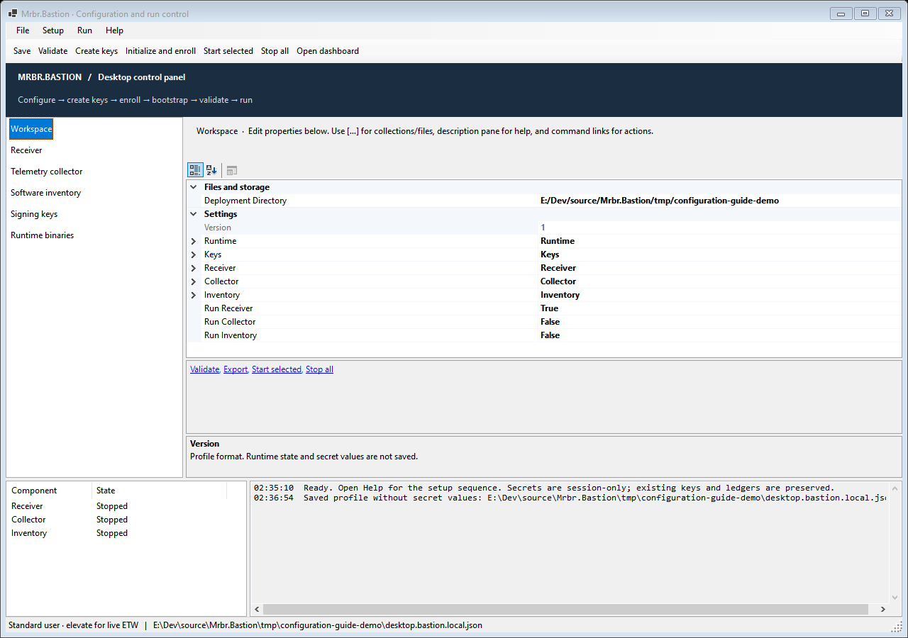

The programs managed by this application are:

| Component | Executable project | Responsibility |
| --- | --- | --- |
| Receiver | `Mrbr.Bastion.Server` | Ingestion, heartbeat verification, health, dashboard, alerts, notifications and enabled software evaluation. |
| Collector | `samples/Mrbr.Bastion.Console` | Process/file ETW telemetry, parent context, durable outbox and signed heartbeat audits. |
| Inventory | `Mrbr.Bastion.Inventory.Agent` | Process/installed-software inventory, optional live lineage, and configured file/archive crawlers. |

The dashboard is hosted by the receiver. It is not a separate program to start.

## 3. Check the binaries to run

Left-click **Runtime binaries**, or press **Ctrl+6**.

| Property | Value/check |
| --- | --- |
| Solution Directory | The folder containing `Mrbr.Bastion.slnx`; the walkthrough detected `E:\dev\source\mrbr.bastion`. |
| Build Configuration | Must match the built output: `Release` in this walkthrough, or `Debug` for a normal Visual Studio Debug build. |
| Dotnet Executable | `dotnet`, or an absolute `dotnet.exe` path. |
| Receiver/Collector/Inventory Executable | Leave empty to use solution build output. Supply a published `.exe` or `.dll` when running without the source build layout. |

**UI observed:** the solution root and Release configuration were detected correctly. Executable overrides were empty. The application starts existing binaries; build them before using Start.

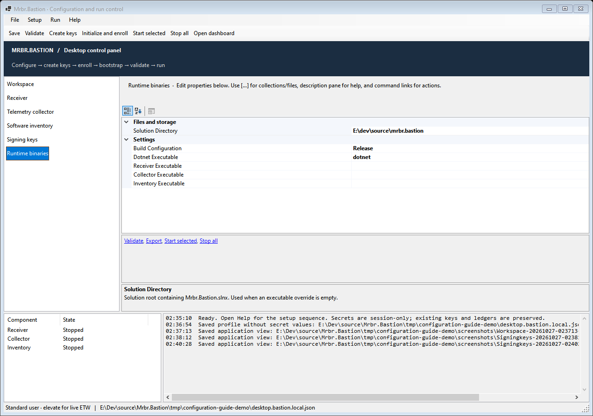

## 4. Configure and create the PEM signing keys

Left-click **Signing keys**, or press **Ctrl+5**. Expand **Receiver** and **Node** using their left-hand arrows. With a property selected, **Right Arrow** or **Numpad +** expands it; **Left Arrow** or **Numpad -** collapses it.

| Pair/property | Default save location relative to the deployment directory |
| --- | --- |
| Receiver → Private Key Path | `keys/receiver-private.pem` |
| Receiver → Public Key Path | `keys/receiver-public.pem` |
| Node → Private Key Path | `keys/node-private.pem` |
| Node → Public Key Path | `keys/node-public.pem` |

For the example directory, the receiver private key would therefore be saved at:

```text
E:\Dev\source\Mrbr.Bastion\tmp\configuration-guide-demo\keys\receiver-private.pem
```

To choose a different location, edit the path value, or left-click its `[…]` path editor. In the file dialog enter the filename and left-click **Save**. Selecting a path does not generate a key.

With all managed processes stopped:

1. Left-click **Create keys** in the toolbar, the command links beneath the grid, or the **Setup** menu.
2. Read the log for the created/verified public fingerprints.
3. Use **Verify keys** to check the configured pairs again.
4. If paths were edited afterwards, **Apply key paths** copies the helper's paths into receiver and agent settings. Review explicit existing enrollment paths separately.

| Operation | Result |
| --- | --- |
| Inspect key settings | **UI observed:** both expandable pairs, four filenames, fixed algorithm and three command links were present. |
| Create a new pair | **Automated test:** generated matching P-256 ECDSA keys, a PKCS#8 private PEM, a SubjectPublicKeyInfo public PEM and a 64-character SHA-256 public fingerprint. |
| Repeat creation at existing paths | **Automated test:** refused to overwrite the existing files; their contents remained unchanged. The desktop's combined Create command verifies an existing complete pair. |
| Verify a mismatched pair | **Automated test:** rejected the mismatch. |

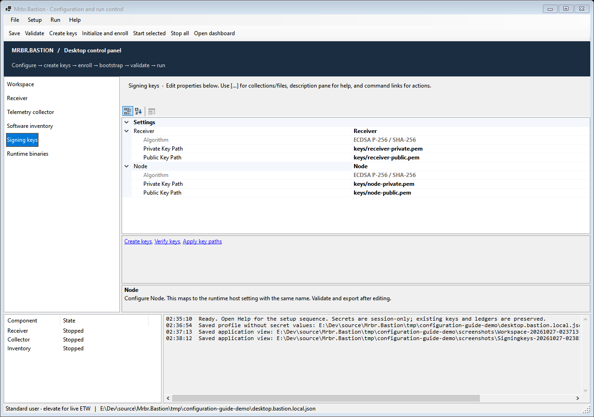

Keep the receiver private key on the receiver and the node private key on the monitored machine. The opposite machine needs the corresponding public verification key. For a local demonstration both pairs can be in the same deployment directory. Generated private files are restricted to the current Windows user; a service running as another account needs deliberate provisioning for that account.

Signing PEMs do **not** supply the receiver's HTTPS certificate.

## 5. Configure HTTPS and the receiving/reporting service

Left-click **Receiver**, or press **Ctrl+2**. Expand **Kestrel → Endpoints → Https**.

| Setting | Example |
| --- | --- |
| Url | `https://localhost:7443` |
| Protocols | `Http1AndHttp2` for HTTP and gRPC on the HTTPS endpoint. |
| Certificate → Path | Empty for the current user's ASP.NET Core development certificate; otherwise the path to an appropriate PFX. |
| Certificate → Password | PFX password for this session only. |

For development, use **Setup → Check HTTPS certificate**. If needed, use **Setup → Trust development certificate** and complete the Windows trust prompts yourself. The command invokes `dotnet dev-certs https --trust`. For a deployed receiver, configure a certificate valid for the hostname used by the agents.

**Environment-check correction:** the initial `dotnet dev-certs https --check` ran under the restricted automation profile and reported **No valid certificate found**. A subsequent check under the same Windows user as the application found trusted development certificates. In the end-to-end run below, the user completed certificate trust through the app and the receiver served HTTPS successfully with ordinary certificate validation.

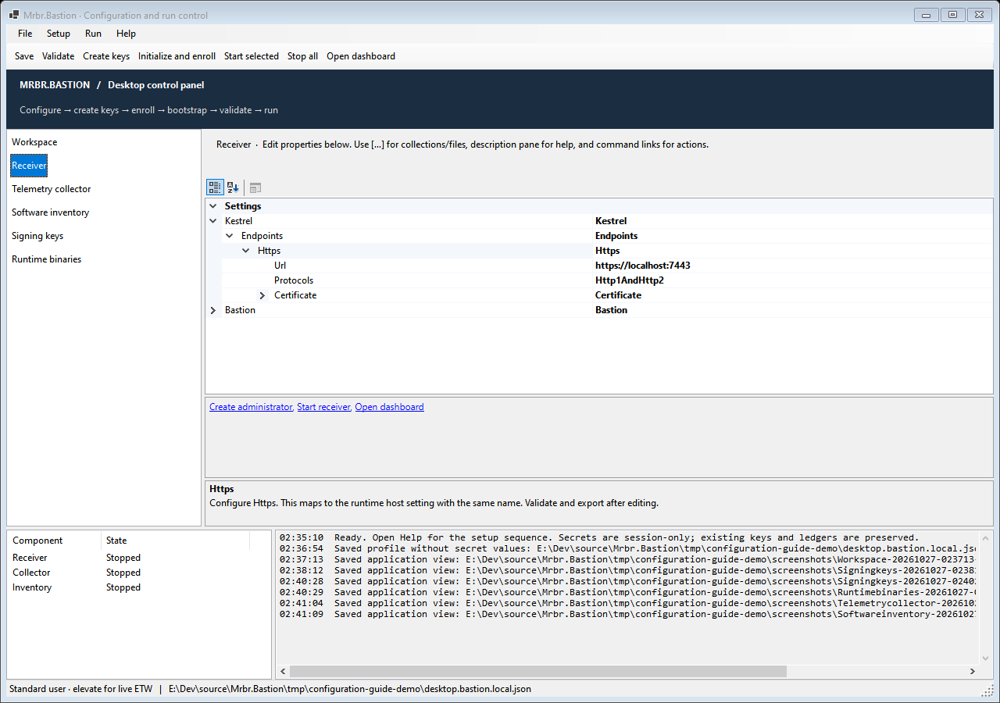

Expand **Bastion** for the remaining receiver configuration:

| Group | What to configure |
| --- | --- |
| Storage and limits | Separate database locations and capacity/request limits. |
| Nodes | Exact node/ledger enrollments and explicitly trusted public keys. The initialization helper fills local selected-agent enrollments. |
| Dashboard | Enable the dashboard; choose `Users`; set operator database/session limits and alert evaluation settings. |
| Notifications | Enable as needed; edit Email/Webhooks collections, delivery limits, retry intervals and destinations. |
| Software | Enable inventory/exposure processing; enable intelligence refresh when required and configure NVD access. Review software/CPE mappings through the authorized dashboard. |

Properties with descriptions display their help in the lower pane. Press **F1** for the selected property's context and the overall setup sequence.

## 6. Configure the telemetry collector

Left-click **Telemetry collector**, or press **Ctrl+3**.

| Property | Example/value |
| --- | --- |
| Node Id | `server-01` — a stable identity for the monitored system. |
| Cache Database Path | `data/telemetry-outbox.db` |
| Node Private Key Path | `keys/node-private.pem` |
| Receiver Public Key Path | `keys/receiver-public.pem` |
| Service Uri | `https://localhost:7443` for a local receiver; use the receiver hostname for another machine. |
| Transport | `http` or `grpc` |
| Send Only | `False` for live monitoring; `True` to deliver an existing outbox without starting ETW. |
| Audits | `True` to send signed heartbeat audits during live collection. |

**UI observed:** these properties and the **Initialize and enroll**, **Start collector**, and **Stop all** command links were displayed. The collector was not started in the walkthrough.

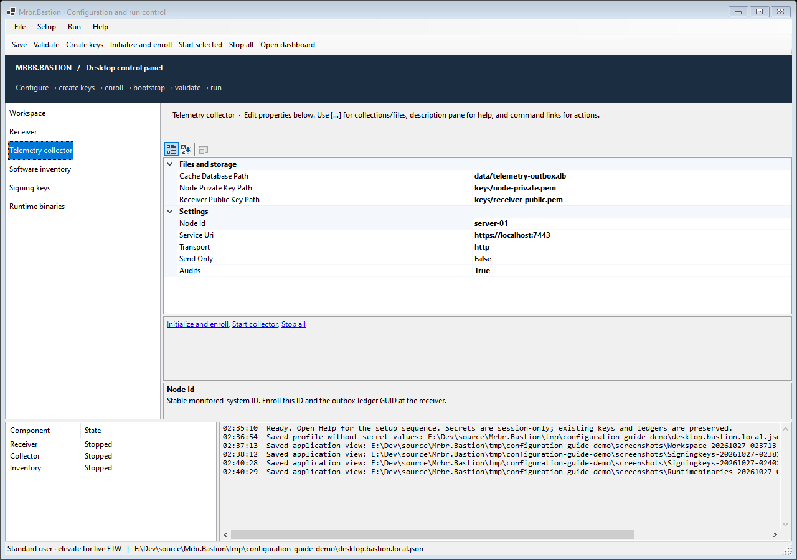

Live ETW collection requires Administrator privileges. Run Visual Studio/the control panel elevated, or use **Help → Restart elevated** and complete the Windows prompt yourself. That command saves the profile before requesting a restart; session-only secrets must be supplied again.

## 7. Configure inventory, lineage and crawlers

Left-click **Software inventory**, or press **Ctrl+4**. Scroll the grid for properties below the current view.

| Property | Example/value |
| --- | --- |
| Node Id | `server-01` |
| Cache Database Path | `data/inventory-outbox.db` — separate from the telemetry outbox. |
| Crawler Database Path | `data/inventory-crawlers.db` |
| Service Uri / Transport | The receiver HTTPS address and chosen transport. |
| Processes / Installed Applications | Enable the sources required for your inventory. |
| Process Events | `True` for live process events and parent context; requires elevation. The walkthrough left it `False`. |
| Baseline Seconds | `60` in the example. |
| Crawlers | File/archive tasks with explicit roots, limits, exclusions and checkpoints. |

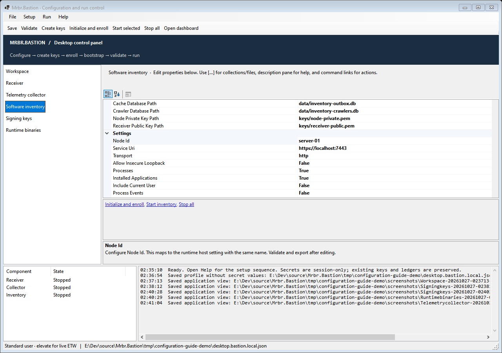

To edit a collection such as **Crawlers**, **Nodes**, **Public Keys**, **Email** or **Webhooks**:

1. Left-click the property's value, then its `[…]` button. **F4** can activate the property's editor when the grid has focus.
2. In the collection dialog, left-click **Add** or select an existing item in the left-hand list.
3. Edit that item's properties in the right-hand PropertyGrid. Nested arrays have their own editors.
4. Use **Move up**/**Move down** to reorder. **Remove** removes the selected configured item from this collection.
5. Left-click **OK** to apply the edited collection, or **Cancel** to retain the original collection.

For a crawler, choose a stable ID such as `applications`, set **Root** to an absolute folder such as `C:\Program Files\YourApplication`, configure extensions/limits, and enable the task deliberately. These example crawler values were not entered or executed in the recorded walkthrough. Collections were inspected through the UI metadata; the collection-dialog steps above describe expected manual use.

## 8. Initialize and enroll the selected ledgers

This is a provisioning step to perform with all managed processes stopped and the required key files present.

1. In Workspace select **Run Collector** and/or **Run Inventory** for the agents to initialize.
2. Left-click **Initialize and enroll**.
3. Read the log for each **NodeId**, exact **ledger GUID**, and current sequence.
4. Inspect **Receiver → Bastion → Nodes**. Save/export the updated configuration before starting the receiver. For a remote receiver, transfer the public-key files and enrollment through your deployment process.

**Automated test:** initializing the two agents produced distinct ledger GUIDs. Repeating initialization returned the same identities and retained two enrollment entries. The resulting keys/enrollments loaded successfully through the server's actual key-material loader.

Do not substitute a guessed GUID or reuse a database for a different identity. Existing enrollment entries and historical key trust are preserved by the helper.

## 9. Create the initial administrator

With the receiver stopped, configure **Receiver → Bastion → Dashboard** with **Enabled = True** and **Authentication Mode = Users**.

1. Left-click **Setup → Create administrator**, or the Receiver section's **Create administrator** link.
2. Enter your chosen username, password and matching confirmation. Passwords must contain 15–128 characters.
3. Left-click **Create**.
4. After starting the receiver, sign in through `/dashboard` and manage additional operators there.

**Expected/manual:** the log reports that the first administrator was created. The password is not written to the profile or log. This dialog is for an empty operator store; it does not replace existing administrators.

**Automated test:** bootstrap created an administrator in a temporary database. A second bootstrap could not replace it, and the original account remained. No username or password was entered in the recorded desktop walkthrough.

## 10. Save the profile and export runtime configuration

| Action | Mouse equivalent | Keyboard used | Observed result |
| --- | --- | --- | --- |
| Save profile | Left-click **Save** or **File → Save**. | **Ctrl+S** | Created `desktop.bastion.local.json` in the demonstration deployment directory. |
| Export runtime settings | Left-click **Export** under the grid or **File → Export**. | **Ctrl+E** | Created `server.json` and `inventory.json`; the log confirmed their directory. |

For a new unsaved profile, Save uses `DeploymentDirectory\desktop.bastion.local.json` when that filename is unused. If it already exists, the application requests a filename instead of silently replacing it. **File → Save as** chooses another profile filename through the save dialog. Enter the path in **File name**, then left-click **Save**.

The following files were verified on disk after the UI commands:

```text
E:\Dev\source\Mrbr.Bastion\tmp\configuration-guide-demo\desktop.bastion.local.json
E:\Dev\source\Mrbr.Bastion\tmp\configuration-guide-demo\server.json
E:\Dev\source\Mrbr.Bastion\tmp\configuration-guide-demo\inventory.json
```

The desktop profile contains all configuration groups. The receiver and inventory runtime files use their host schemas. The collector is started with its configured command-line arguments rather than a separate collector JSON file.

**Automated test:** exported receiver settings bound to `ServerSettings`, and exported inventory settings decoded and validated using the inventory agent's contract. SMTP passwords, access/bearer tokens, webhook signing secrets, NVD API keys and PFX passwords were absent from saved/exported files. Non-secret values and collections survived a profile round trip.

Secret fields are masked and session-only. Re-enter them after loading a profile, or provision them through the receiver environment. PEM contents are not embedded in profiles; only their file paths are recorded.

To reopen a profile, left-click **File → Open** or press **Ctrl+O**. In the dialog enter the profile's filename and left-click **Open**. Reopening through the file dialog was not part of the recorded UI walkthrough; profile loading/round-trip behavior was verified by automated tests.

## 11. Validate, start, observe and stop

After keys, enrollment, HTTPS and operator setup are complete:

| Instruction | Input | Expected result |
| --- | --- | --- |
| Validate selected settings | Left-click **Validate**, or **Ctrl+L**. | The log confirms selected configuration/binaries validated, or reports a specific error to correct. Validation does not establish remote connectivity or certificate trust. |
| Start selected components | Left-click **Start selected**. | Runtime files are exported; selected components launch in receiver/inventory/collector order. State rows show `Running · PID …`; output is prefixed by component name. |
| Start one component | Choose the corresponding **Run** menu command or section command link. | That component starts using the current configuration. |
| Open reporting | Left-click **Open dashboard**. | Opens the configured receiver's `/dashboard` URL, for example `https://localhost:7443/dashboard`. |
| Stop gracefully | Left-click **Stop all**, or **Ctrl+Shift+F5**. | Stops inventory, collector, then receiver through authenticated local shutdown requests; states return to `Stopped`. |
| Stop an unresponsive process | Choose **Run → Force stop**, review the warning and confirm if appropriate. | Terminates the processes started by this control panel; uncommitted observations can be lost. |

The PropertyGrid is locked while managed processes are running. Stop them before editing settings, changing keys, enrolling ledgers, bootstrapping an operator, or exporting changed runtime configuration.

**Recorded UI result:** all processes remained stopped because the walkthrough did not provision signing files or HTTPS trust and did not collect real host data. Start, dashboard sign-in, force termination, and privilege/trust prompts were not exercised through the GUI.

**Automated result:** the managed-process test launched a child process, received `CONTROL READY`, sent an authenticated shutdown request and received `CONTROL STOPPED` before exit without force termination. A separate test rejected an incorrect control token. Existing executable-host integration tests also passed in the full suite.

## 12. Capture your own screenshots

1. Select the section and expand the settings you want to show.
2. Left-click **File → Save screenshot**, or press **Ctrl+Shift+F12**.
3. Read **Saved application view:** in the log for the exact PNG filename.

Files are written beneath:

```text
<DeploymentDirectory>\screenshots\
```

The filename includes the section, timestamp and a unique suffix, so successive captures do not overwrite one another. This command captures the current main application view; it does not capture separate dialogs or other applications. Review images before sharing them, especially when custom values are present.

**UI observed:** six views were captured and copied into `images/configuration-guide/` for this document. Both receiver and node key locations, detected binary settings, collector configuration, inventory Process Events, receiver HTTPS settings and the configured workspace are visible in the images above.

## Keyboard reference

| Keys | Operation |
| --- | --- |
| Ctrl+1 | Workspace |
| Ctrl+2 | Receiver |
| Ctrl+3 | Telemetry collector |
| Ctrl+4 | Software inventory |
| Ctrl+5 | Signing keys |
| Ctrl+6 | Runtime binaries |
| Ctrl+S | Save profile |
| Ctrl+O | Open profile |
| Ctrl+E | Export runtime configuration |
| Ctrl+L | Validate selected settings |
| Ctrl+Shift+F5 | Graceful Stop all |
| Ctrl+Shift+F12 | Save the current application view as PNG |
| F1 | Contextual help |
| Tab / Shift+Tab | Move focus between controls |
| F2, Ctrl+A, text, Enter | Edit/replace/commit an editable grid value |
| Right / Numpad + | Expand a selected object |
| Left / Numpad - | Collapse a selected object |
| F4 | Activate an available property editor |
| Escape | Cancel the current edit or dismiss a cancellable dialog |

## Verification record

| Check | Result |
| --- | --- |
| Release solution build | Passed; zero warnings/errors. |
| Core/integration suite | 341 passed, 3 skipped, 344 total after the ETW startup fix. |
| Separate WinForms suite | 5 passed, 0 skipped, including checks for displaying a loaded profile immediately and preserving the owner window/profile arguments for elevation. Actual Windows consent is a manual check. |
| Skipped checks | Two elevated live ETW checks (including concurrent sources) and the opt-in OS TLS transport test. |
| UI profile save | Observed, then checked on disk. |
| UI runtime export | Observed; both JSON files checked on disk. |
| Screenshots | Six actual WinForms PNG views, visually checked. |
| Development certificate environment | Initial restricted-profile check was superseded by normal-user trust verification and the successful HTTPS checks in Section 13. |
| Live collection / real notifications | The initial walkthrough kept collection stopped; Section 14 verifies live collection. Outbound notifications stayed disabled. |

This guide and its images are outside the Git-ignored `docs/` directory. Demonstration profiles, screenshots at their original runtime location, and test reports remain beneath ignored `tmp/`. Do not copy private signing material or live databases into the tracked guide/image folders.

## 13. Local end-to-end run — 27 October 2026

This run uses a separate profile and data directory, preserving the original demonstration and the existing application window:

```text
E:\Dev\source\Mrbr.Bastion\tmp\e2e-local-20261027\desktop.bastion.local.json
```

The initial profile specified only the deployment directory, source directory and Release build. Signing keys, agent settings and enrollment were then provisioned through the configuration app.

| Step | Actual app interaction | Observed result |
| --- | --- | --- |
| Load isolated profile | Start the isolated control-panel build with `--profile` and the filename above. | The displayed Deployment Directory matches the test profile. A startup display bug found during this check was fixed, and a new WinForms regression test passed. |
| Create signing pairs | Open **Setup** with `F10`, `Right`, `Down`; select **Create keys** with `Down`, `Enter`. | The app generated four new PEM files under `keys/` and logged two public fingerprints. Existing files were not replaced. |
| Configure telemetry | `Ctrl+3`; set **Node Id** to `e2e-local-01` and **Service Uri** to `https://localhost:7447`. | Both values appeared in the collector grid. |
| Configure inventory | `Ctrl+4`; set the same Node Id and Service Uri; set **Process Events** to `True`. | Inventory targets the same HTTPS receiver and requests live process/parent observations. |
| Configure receiver | `Ctrl+2`; expand **Kestrel → Endpoints → Https** with arrows/`Numpad +`; set **Url** to `https://localhost:7447`. | Receiver and both agents use port 7447; receiver protocols remain `Http1AndHttp2`. |
| Enroll agents | Open **Setup → Initialize and enroll** using the menu keys. | Two outboxes were initialized at sequence 0 and two exact ledger enrollments were added. |
| Save/export | `Ctrl+S`, then `Ctrl+E`. | Desktop profile, `server.json` and `inventory.json` saved to the isolated directory; settings were checked on disk. |
| Capture setup evidence | `Ctrl+Shift+F12`. | PNG records the configured HTTPS endpoint and the key/enrollment log. |
| Request elevation | **Help → Restart elevated**. | Saved the profile and requested the Windows elevation handoff. Windows approval, certificate trust and test-operator password entry require the user's direct input. |

Public setup identifiers from this run:

| Item | Value |
| --- | --- |
| Node Id | `e2e-local-01` |
| Telemetry ledger | `169635e2-b3e4-4e65-841c-0577eea2363f` |
| Inventory ledger | `08091919-30af-4bdc-b56e-d26aaff1757e` |
| Receiver public-key fingerprint | `254676B5F5B97A35BD00C2E4E53E719D0C458A048B2D118AFD8BB52F132A8872` |
| Node public-key fingerprint | `A01D47E1E1ECB057BE6550BE3345D44014BFA0D932F7C7974B2F7BB6737E6AE7` |

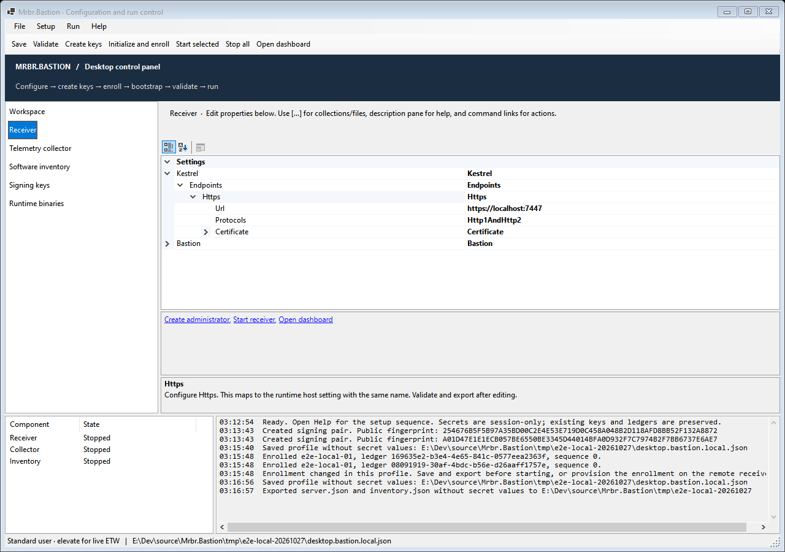

### Security handoff and runtime verification

The user completed **Setup → Trust development certificate** and **Setup → Create administrator**. The app logged successful certificate trust and initial administrator creation. A read-only check confirmed that `local-test-operator` is enabled with the Administrator role; no password or password hash was read or recorded. A normal-user `dotnet dev-certs https --check --trust` confirmed trusted development certificates.

Two elevation attempts returned Windows' cancellation error after approximately two minutes. The user reported that **no elevation prompt appeared**; this was not a confirmed user refusal. The test application's status bar still read **Standard user**. The following receiver-only checks were therefore completed before attempting live ETW:

| Runtime check | Actual action/result |
| --- | --- |
| Start receiver through the app | **Run → Start receiver** launched PID 8132. The app logged `Now listening on: https://localhost:7447`. The collector and inventory remained stopped. |
| Verify HTTPS | A GET to `https://localhost:7447/api/v1/telemetry/capabilities` returned **200**, using normal certificate validation. It advertised `mrbr.bastion.events+json;v=1` and `mrbr.bastion.inventory+json;v=1`. |
| Open dashboard | The browser reached `https://localhost:7447/dashboard/login` over HTTPS and displayed the named-user sign-in form. No certificate-warning bypass was used. Authenticated sign-in and data inspection remain pending. |
| Capture receiver state | **Ctrl+Shift+F12** captured the actual running receiver, its PID, startup/HTTPS request log, and stopped agent states. |
| Stop receiver gracefully | **Ctrl+Shift+F5** requested **Stop all**. The receiver logged `Application is shutting down...`; PID 8132 subsequently exited and port 7447 was no longer listening. Force termination was not used. |

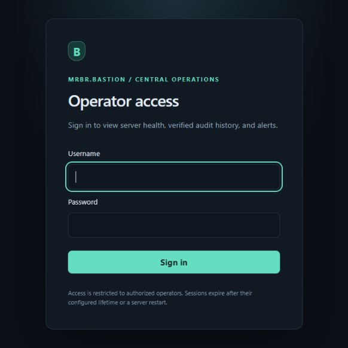

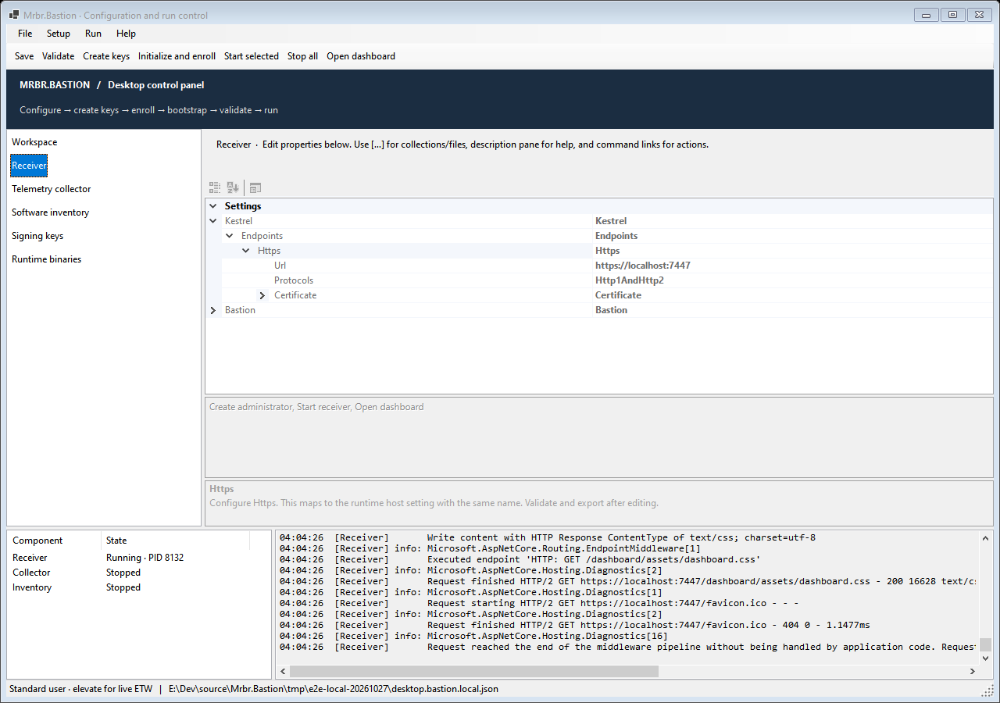

### Readiness before live agents

The receiver-only check did not verify live collection, accepted telemetry/inventory blocks, signed heartbeat assessments or authenticated dashboard data. The subsequent elevation and first live attempt are recorded below; Section 14 records the successful functional retry and its performance findings.

The elevation handoff has been revised to pass the control panel's owner-window handle to Windows, keep the form responsive while awaiting approval, and report the native Windows error with recovery paths. The original window stays open if launching the replacement fails. These changes do not establish why the earlier prompts were invisible. Microsoft documents the [owner handle as controlling the positioning of Shell execution UI](https://learn.microsoft.com/en-us/windows/win32/api/shellapi/ns-shellapi-shellexecuteinfow).

For a direct launch from the user's desktop, use this standard shortcut, which preserves the saved profile argument:

```text
E:\Dev\source\Mrbr.Bastion\tmp\e2e-local-20261027\Launch Bastion test.lnk
```

In File Explorer, **right-click** the shortcut and select **Run as administrator** (on Windows 11, **Show more options** may be needed). The user must approve Windows' prompt directly. Verify that the new window's bottom status bar says **Administrator**, and that the loaded profile is `e2e-local-20261027\desktop.bastion.local.json`. Leave all components stopped until the live test resumes. The updated executable is:

```text
E:\Dev\source\Mrbr.Bastion\tmp\e2e-ui-build-v2\Mrbr.Bastion.Desktop.exe
```

Keep the existing `e2e-local-20261027` profile. Certificate trust, signing keys, enrollments and the test operator have already been provisioned and should not be recreated.

### Direct elevation result and live-test handoff

The user launched the prepared shortcut and confirmed that the updated app's status bar says **Administrator**. Initially a separate standard-user configuration window was also open; a later process check found only the Administrator instance. Computer Use detected the elevated window but reported that its accessibility is limited because it has higher Windows integrity than the helper. An attempted `Ctrl+Shift+F12` through the helper did not create a screenshot. Subsequent elevated app actions must therefore be performed directly by the user; this is recorded separately from automated observations.

The requested live-test sequence is **Start selected**, approximately 45 seconds of collection, **Ctrl+Shift+F12** to capture the actual state, then **Ctrl+Shift+F5** to stop all components gracefully. After all three show **Stopped**, use **Run → Start receiver** to serve the persisted results for dashboard inspection.

### First live attempt — ETW startup failure

The user clicked **Start selected** with all three components selected. All three processes launched, but both agents then stopped with:

```text
System.Exception: The kernel provider must be enabled first and only once in a session.
```

The receiver continued running; the user subsequently stopped it. The app's saved screenshot confirms **Administrator** status, a running receiver and both stopped agents. The visible log portion shows the inventory agent exiting with code 1; the exception text above comes from the user's report.

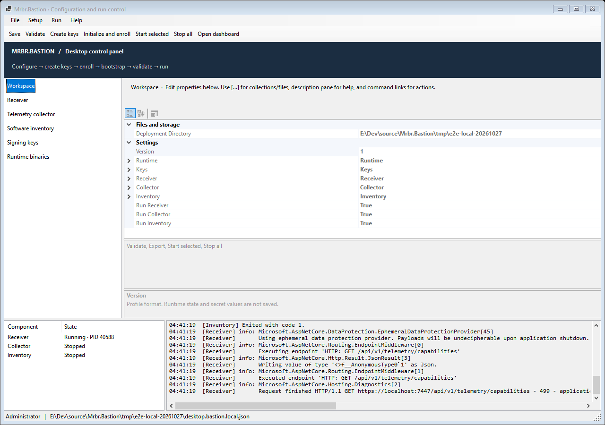

Read-only database checks after shutdown found **82 pending inventory blocks**, **0 telemetry blocks**, **0 centrally ingested blocks** and **0 heartbeat audit entries**. These pending inventory records were preserved. A read-only `logman query -ets` check found **0 active Mrbr.Bastion sessions**; no session cleanup or system setting change was needed.

The shared `WindowsEtwTelemetrySource` accessed `TraceEventSession.Source` before `EnableKernelProvider`. The installed TraceEvent 3.1.19 source getter starts the session, causing the subsequent kernel-provider call to reject it. Startup now enables the combined process/thread/file flags once **before** opening the event source. Each agent retains its unique session name. See the [upstream TraceEvent implementation](https://github.com/microsoft/perfview/blob/main/src/TraceEvent/TraceEventSession.cs).

The Release solution rebuilt with **0 warnings and 0 errors**. The core suite passed **341 tests**, with **3 skips** (two tests requiring an Administrator test host and the opt-in TLS test). The desktop suite passed **5 tests**. The added live regression starts file and process-only sources together, observes a child through both, stops the file source and checks that the process-only source continues receiving another child. Its actual elevated execution remains pending; the normal test host cannot run it.

Both runtime agents were rebuilt in their configured Release locations. The existing Administrator control panel then used **Start selected** again without changing the profile or recreating keys, certificates, ledgers or the operator. The retry results follow.

## 14. Successful functional retry and verified results

The user repeated **Start selected** in the Administrator window, confirmed that all three components stayed running, captured the app with **Ctrl+Shift+F12**, stopped all components with **Ctrl+Shift+F5**, and then used **Run → Start receiver** for reporting. The saved 04:58:11 UTC screenshot shows Receiver PID 5720, Collector PID 35516 and Inventory PID 21644 running together, with HTTPS ingestion requests returning **200**. The requested wait was approximately 45 seconds; the retained audits span more than a minute, so this record does not assume an exact 45-second capture.

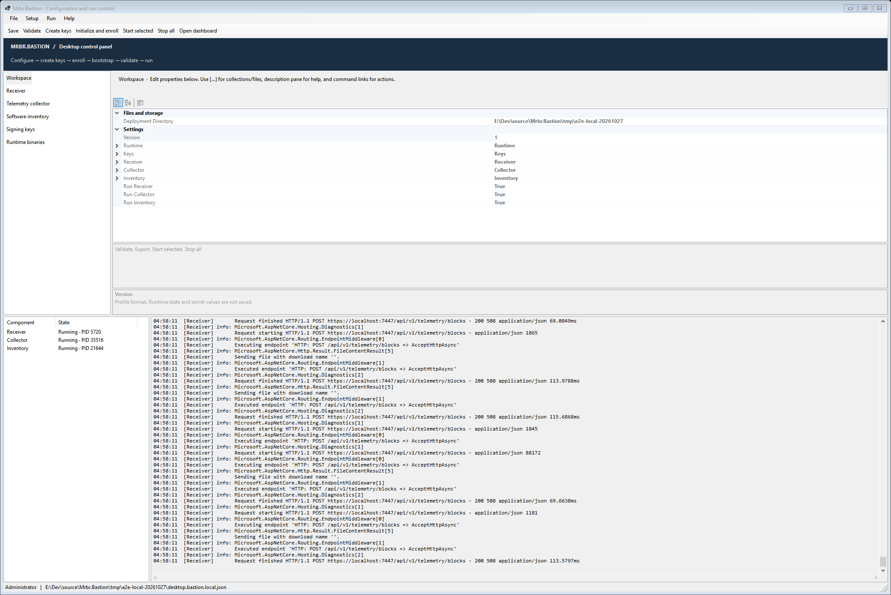

### Durable delivery and signature verification

Stopping collection preserves unsettled blocks for later delivery. The initial read after shutdown found telemetry at **831 blocks / 485 settled** and inventory at **1,744 blocks / 607 settled**. Supporting CLI checks reopened both stopped outboxes and verified their retained chains and existing receipt signatures. The following send-only commands then drained their backlogs to the already-running receiver. This supporting step was performed from the shell, rather than through the elevated GUI, and did not start ETW collection.

From `E:\Dev\source\Mrbr.Bastion`, the commands used were equivalent to:

```powershell
$testDirectory = 'E:\Dev\source\Mrbr.Bastion\tmp\e2e-local-20261027'

dotnet .\samples\Mrbr.Bastion.Console\bin\Release\net11.0\Mrbr.Bastion.Console.dll `
  e2e-local-01 "$testDirectory\data\telemetry-outbox.db" `
  "$testDirectory\keys\node-private.pem" "$testDirectory\keys\receiver-public.pem" `
  http https://localhost:7447 --send-only

dotnet .\Mrbr.Bastion.Inventory.Agent\bin\Release\net11.0\Mrbr.Bastion.Inventory.Agent.dll `
  "$testDirectory\inventory.json" --send-only
```

Both commands exited **0**. Telemetry settled **346 additional blocks** and inventory settled **1,137 additional blocks**, each with **0 transient failures**. Subsequent agent integrity checks exited **0**, verifying all newly stored signed receipts. A read-only comparison confirmed every block hash and receipt against the central store, with matching ledger tips. Receipt comparisons normalized JSON property-name casing between the local and central serializers while retaining all values and signatures.

| Verification | Telemetry | Inventory |
| --- | ---: | ---: |
| Retained signed blocks | 831 | 1,744 |
| Centrally accepted blocks | 831 | 1,744 |
| Validated settlement receipts | 831 | 1,744 |
| Matching central blocks and receipt contents | 831 | 1,744 |
| Blocks still pending | **0** | **0** |
| Local/central ledger tips match | Yes | Yes |
| SQLite quick check | `ok` | `ok` |

The central ingestion database also returned `ok` for its SQLite quick check. Aggregate results are saved in the ignored test file `tmp/e2e-local-20261027/verification-results.json`; private PEMs and live databases remain outside the tracked guide/image directories.

The inventory total includes the 82 pending blocks preserved from the first failed attempt.

### Dashboard interactions and observed results

The browser used `https://localhost:7447/dashboard`. The user entered **local-test-operator** and their private temporary password, then clicked **Sign in**. The authenticated page displayed that operator's name. Password entry, password hashes and session cookies were not read or recorded.

| Action / text | Input used | Actual result |
| --- | --- | --- |
| Open server fleet | Left-click **Servers**. | Two rows represent the telemetry and inventory **node/ledger enrollments** on this one host. They are not two physical computers. |
| Open telemetry details | Left-click **e2e-local-01 · telemetry**. | Last accepted heartbeat `2026-10-27 04:57:55 UTC`, latest audit **#3**, and current health policy were visible. |
| Review audit history | Select **Heartbeat audit history**. | Audits **#3, #2 and #1** displayed **Running** collector observations and **Verified** local caches. |
| Inspect retained signed evidence | Left-click the first **View evidence** button, then **Close evidence**. | The dialog displayed the signed request, receiver challenge, node response and original central result. Their signatures and bindings are verified by the server on read. |
| Review alerts | Left-click **Alerts**, retaining the default **Active** filter. | Three open conditions: **Heartbeat offline** (Critical), **New events lost** (Warning), and inventory **No accepted heartbeat** (Warning). No acknowledgements were submitted. |
| Review inventory | Left-click **Software & CVEs**, keeping the inventory ledger selected. | Software observations and version evidence appeared; status explicitly showed **NVD disabled**. |
| Capture a limited inventory example | Left-click **Search inventory**, enter `winlogon.exe`, then left-click **Search**. | Two retained Windows system-process observations displayed product/file versions. Parent evidence remained qualified as unknown or an uncorrelated reported PID. |

The narrow browser pane uses horizontal table scrolling; drag the horizontal scrollbar to see columns beyond the screenshot's visible area. The public screenshots preserve the actual layout. The historical inventory screenshot is withheld from the public release because it exposes actual host software/version evidence; the original remains local and the aggregate verification results below are retained.

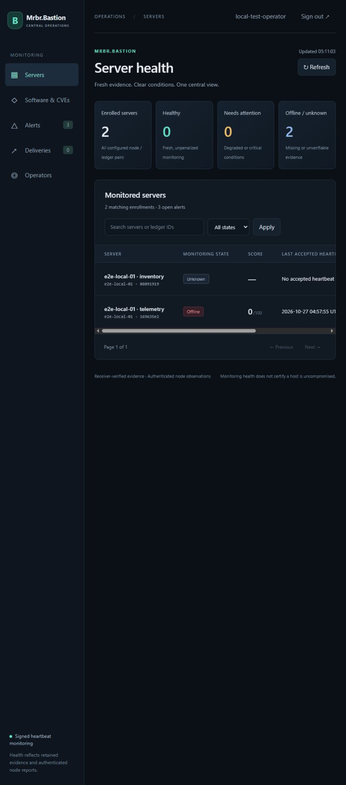

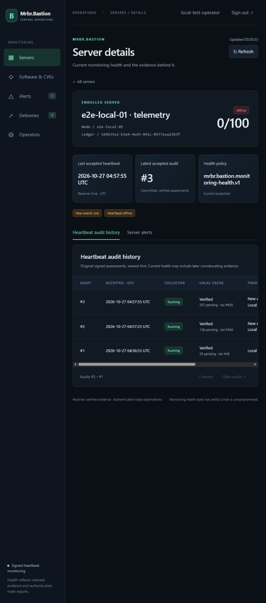

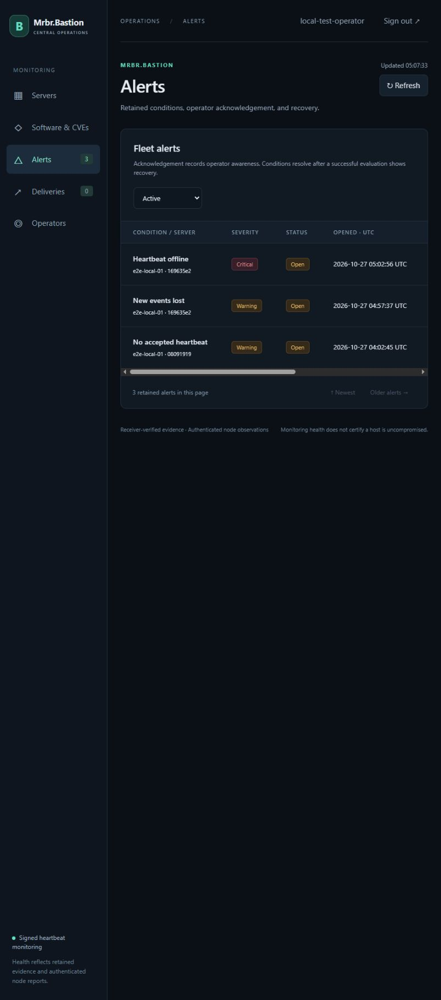

*Inventory screenshot withheld from the public release after privacy review. The original local capture was not edited or deleted.*

### What the run established, and the findings it exposed

The functional path succeeded: generated signing keys, trusted local HTTPS, enrollment of both durable ledgers, live collection by both agents, central acceptance, verified signed settlement receipts, three signed heartbeat audits, operator sign-in, and dashboard reporting. **2,575 blocks** were fully settled. The telemetry ledger contains **83,092 retained events**. The inventory projection contains **1,547 items**: **668 running-process observations** and **879 installed-application observations**. Four inventory items contain observed parent-process context; this is observation evidence, not proof of the true initiating caller.

The run exposed a substantial **capacity and same-host feedback issue**. At audit #3, the collector reported **9,813,379 received events**, **9,744,587 queue-dropped events**, **0 source-reported ETW losses**, and **60,500 persisted events** at that sampling instant. The eventual retained total of 83,092 is measured after collection stopped and drained. Successfully settling retained blocks does not recover events already rejected by the bounded queue.

Of the retained events, **59,047** came from the receiver process and **13,407** from the inventory process; **68,254 file events** referenced the isolated deployment directory. The collector's own PID contributed **0** retained events. These measurements support a feedback explanation: monitoring the local receiver/inventory storage activity produces more collection and ingestion work. A follow-up should introduce explicit handling of Bastion's runtime I/O and repeat a bounded workload test before sustained same-host monitoring. This run does not establish a loss-free operating capacity.

Health and coverage results must be read in that context:

- Telemetry was **Critical, score 35**, while the recent loss finding was active; after the collector remained stopped beyond the configured five-minute deadline, both the dashboard and a separately verified signed health query showed **Offline, score 0**.
- Inventory remained **Unknown / No accepted heartbeat** because this agent delivers inventory on its own ledger but does not currently emit the collector's signed heartbeat audits. Successful inventory ingestion is established by its receipts and projection, rather than that health score.
- NVD intelligence and outbound notifications were disabled for the isolated run. This test verifies neither live CVE-feed freshness nor email/webhook delivery. gRPC block delivery was not part of this HTTP-over-HTTPS run.
- The two elevated ETW regression tests remain skipped in the standard test host. The observed app run established concurrent operation of both agents; independent execution of those automated elevated tests remains a separate check.

### Final shutdown

After all dashboard screenshots and verification results were saved, the user pressed **Ctrl+Shift+F5**, waited for all three components to show **Stopped**, and saved one final view with **Ctrl+Shift+F12**. The 05:12:38 UTC screenshot confirms all three stopped and shows the receiver logging `Application is shutting down...` followed by **Exited with code 0**.

Independent checks found **0 listeners on port 7447**, **0 active Mrbr.Bastion ETW sessions**, and **0 child processes of the test control panel**. The Administrator configuration window was left open with the prepared profile. This completed the original functional test; Section 15 records the subsequent work on its capacity/feedback finding.

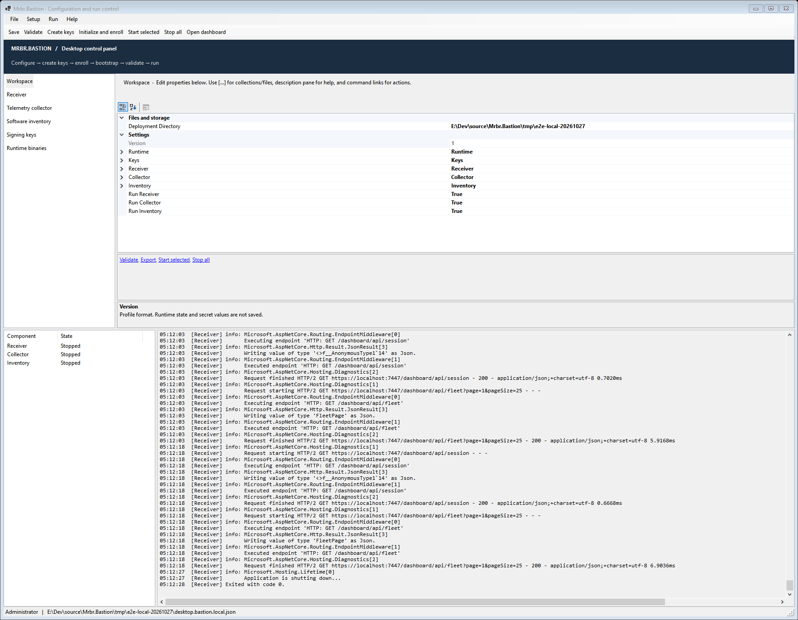

## 15. Same-host feedback correction and bounded verification

The original keys, operator, HTTPS trust, enrollments, ledger identities and retained history were preserved. A separate profile was saved at:

```text
E:\Dev\source\Mrbr.Bastion\tmp\e2e-local-20261027\feedback-test.bastion.local.json
```

The updated control panel is the normal Release build at `Mrbr.Bastion.Desktop\bin\Release\net11.0-windows\Mrbr.Bastion.Desktop.exe`. The prepared **Run feedback verification.lnk** shortcut loads this profile. The user launched it as Administrator and verified its status bar. An older isolated control-panel window may also be open; select the window whose footer names **feedback-test.bastion.local.json**.

### Settings, input and behavior

| Action / input | Configured value or result |
| --- | --- |
| Select **Telemetry collector**, or press **Ctrl+3** | Displays the collector's PropertyGrid, help descriptions and commands. |
| **Exclude Managed Process File Io** | `True`. The panel supplies exact process IDs and creation times for itself and the receiver/inventory processes it launches. The collector retains OS process handles so an exited process's exclusion cannot transfer to a reused PID. |
| **Queue Capacity** | `8192` events, the original default. |
| **Batch Size** | `100` events, the original default. |
| **Flush Interval Milliseconds** | `1000`, the original default. Scroll the grid to see lower rows. |
| **Etw Buffer Size Megabytes** | `64`, the original default. |
| Select **Workspace**, or press **Ctrl+1** | Receiver, collector and inventory selected; **Selected Run Duration Seconds** set to `120`. Zero restores continuous operation. |
| Press **Ctrl+S** | Saves the profile without secret values. |
| Left-click **Start selected** | Exports runtime JSON; starts receiver, inventory, then collector. A peer started later receives an authenticated file-I/O policy refresh. |
| At approximately 60 seconds | The app saves a midpoint screenshot automatically. |
| At 120 seconds | The app requests graceful Stop all, saves a final screenshot, and writes the visible command log beneath the deployment directory's `logs` folder. Shutdown can extend the total elapsed time. |
| Manual **Ctrl+Shift+F5** | Requests graceful Stop all and cancels the timed run. Individual component Start commands are untimed. |

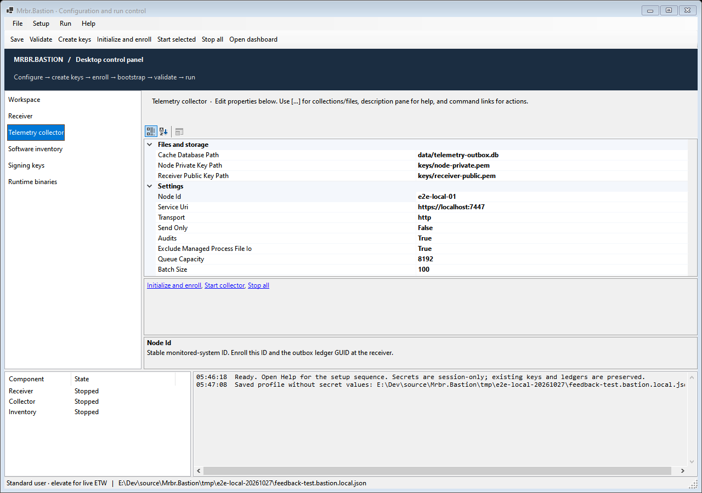

This settings screenshot was captured from the standard-user preview before the elevated run. Live screenshots must show **Administrator** in the footer. Windows integrity restrictions prevent the normal Computer Use helper from controlling the elevated window, so the user performs its Start action; the app itself saves the bounded-run screenshots. Keys, passwords and other windows are excluded from these captures.

File-I/O exclusions run in the raw ETW callback before copied-event creation or bounded-queue admission. Process start, snapshot and exit events remain collected, including Bastion's own process lifecycle. Descendants, unrelated processes and other actors accessing Bastion's files remain observable. The exact current session's `EtwRTMrbr.Bastion…etl` transport artifact is additionally suppressed only when accessed by the Windows System process (PID 4); other System files and other sessions' transport files remain in scope. Intentionally filtered events have their own health count; queue drops and ETW source losses remain separate signed audit evidence.

The source also uses a randomly seeded, per-run event-ID sequence in its single dispatch thread. Restoring a serialized event keeps its original ID without generating a replacement. Cryptographic block IDs, signatures, audit challenges and nonces retain their existing behavior.

### Intermediate runs and regression checks

The intermediate bounded attempts remain in the retained ledger/audit history:

| Attempt | Received | Intentionally filtered | Queue dropped | ETW source lost | Persisted events | Final unpersisted |
| --- | ---: | ---: | ---: | ---: | ---: | ---: |
| 05:50–05:52 UTC; filter after event creation | 34,455,957 | 33,806,592 | 594,673 | 52,068,923 | 54,692 | 0 |
| 06:15–06:18 UTC; process filter before event creation | 42,679,862 | 41,743,645 | 895,225 | 37,819,968 | 40,992 | 0 |
| 07:06–07:08 UTC; exact transport-path filter and event-ID sequence | 43,019,366 | 42,297,116 | 688,958 | 35,144,954 | 33,292 | 0 |
| 07:19–07:21 UTC; local cache metadata indexes | 30,102,009 | 29,556,921 | 230,240 | **0** | 314,848 | 0 |
| 10:54–10:56 UTC; concurrent audit snapshot and central capacity index | 2,729,609 | 2,473,743 | 92,453 | **0** | 163,413 | 0 |

All five stopped their components with exit code 0. These are failed capacity checks, despite successful local draining of accepted events. Inspecting retained System events exposed the current collector's ETW transport backup file, motivating the additional exact-file exclusion. The third run still retained many System writes whose paths were unknown; unknown paths were not silently excluded. The fourth eliminated source-reported ETW loss and substantially increased persistence. The fifth substantially reduced the raw event rate, but the original queue/batch settings still dropped events during bursts.

Investigation then found repeated table scans in the durable cache: every append summed `payload_bytes`, and status/pending queries scanned retained rows containing large payload and receipt BLOBs. The saved telemetry outbox had grown to about 172 MB. SQLite's query plan explicitly showed `SCAN blocks` for these metadata queries. This repeated storage activity is an additional source of same-host tracing work; the query plan alone does not quantify all causes of the raw event rate.

The cache now creates a covering payload-size index and a partial index over pending sequences/sizes. Status queries calculate pending/total values from those indexes. Existing outboxes are verified before this derived-index migration; startup and signed heartbeat integrity checks still verify the full retained chain and receipts. Both saved test outboxes passed the updated agents' `--inspect` checks with exit code 0. Their actual size-query plan then showed `USING COVERING INDEX blocks_payload_size`, and their pending-query plan showed `USING INDEX blocks_pending`.

Full heartbeat verification also held the cache writer lock while reading all retained evidence. It now establishes a separate read-only WAL snapshot under that lock, then verifies its complete chain and receipts while the writer continues. The snapshot's checkpoint and pending counts remain internally consistent; completion cannot rewind the active writer's checkpoint. Audit operations remain serialized, and disposal waits for the active audit. This uses SQLite's documented [WAL reader/writer concurrency and snapshot semantics](https://www.sqlite.org/wal.html).

The receiver had the same payload-table scan in its capacity check. It now adds a covering payload-size index after verifying an existing store. Original block contents, receipts and identities remain intact. The supporting receiver run confirmed that its actual capacity query uses this covering index.

The fifth run's first live audit (**#18**) had zero queue drops/source losses and the dashboard showed **Healthy, 100/100**. Later audits **#19–#20** correctly reported loss and **Degraded, 75/100**; the early healthy observation does not establish a loss-free run. The user signed in directly with the existing private temporary password. The browser inspected the telemetry details. Its saved history screenshot also shows **Failed to fetch** because it overlapped the receiver's timed shutdown; the displayed audit history is the last loaded data.

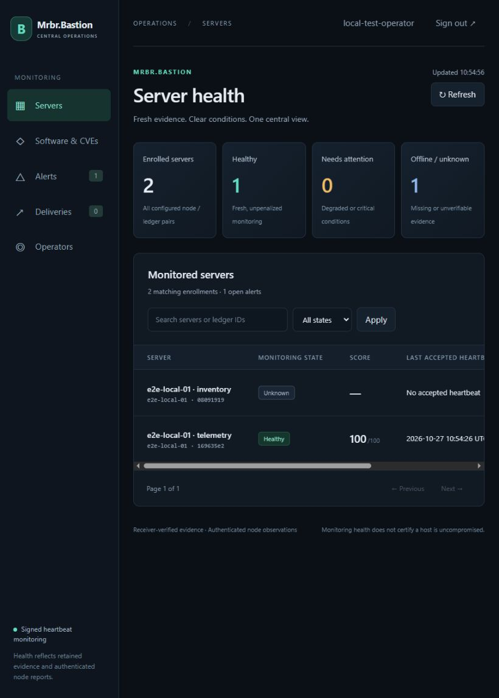

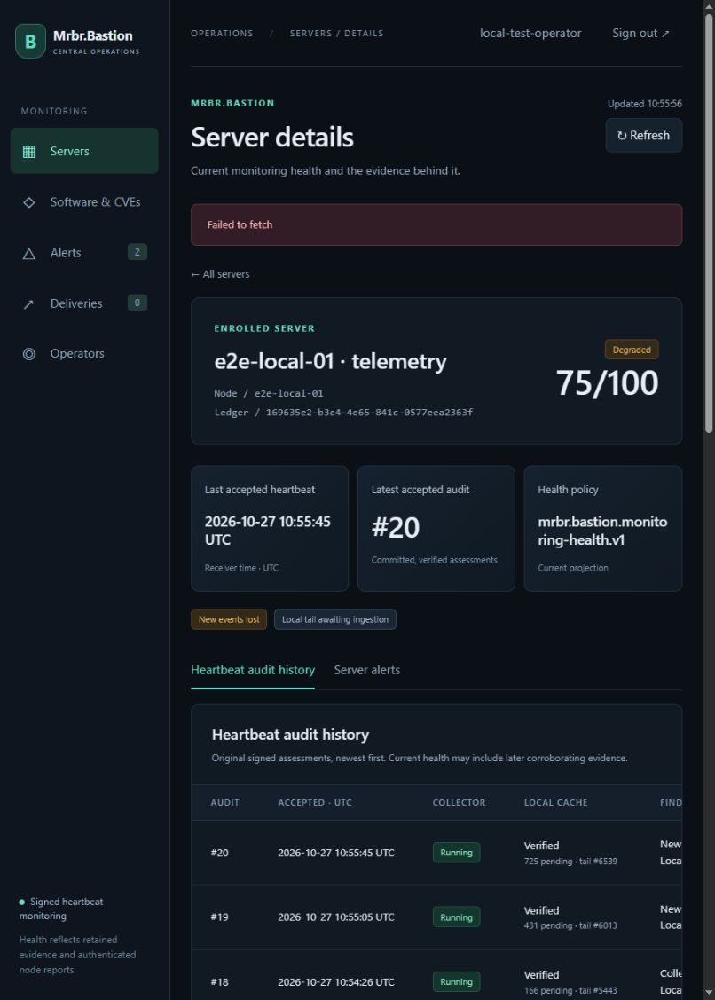

Supporting send-only delivery then settled **879 telemetry** and **1,267 inventory** blocks with zero transient failures. The temporary receiver was stopped gracefully. All **6,905 telemetry** and **12,772 inventory** blocks were settled before the next comparison; original evidence and prior loss history were retained.

After these corrections, the Release regression suite passed **362 tests** with **3 opt-in tests skipped**. The separate WinForms suite passed **5 tests**. Tests cover process-lifetime binding, lifecycle/descendant retention, raw filtering before event creation, counter accounting, exact transport-file scope, retained event IDs, command-line validation, authenticated policy refresh, migration/query plans for existing outboxes and central stores, and concurrent full-audit snapshots. One concurrent build/test attempt encountered Windows file-sharing cleanup failures; subsequent sequential full runs passed without failures.

### Verified throughput comparison

The original default settings were preserved for the preceding comparisons. The successful run used a separate, explicitly tuned profile:

```text
E:\Dev\source\Mrbr.Bastion\tmp\e2e-local-20261027\feedback-tuned.bastion.local.json
```

It selects **Queue Capacity `32768`**, **Batch Size `1000`**, the same **1000 ms flush** and **64 MB ETW buffers**, and a **90-second bounded run**. Larger batches amortize durable transaction/signature overhead; the larger queue absorbs bursts. The shorter run reserves space within the existing 512 MB retained-payload limit after the failed tests; no retained evidence is deleted and the capacity limit is not raised.

The user performed these steps with all components stopped: **Ctrl+O**, the full path above, **Enter**, **Ctrl+3**, then left-click **Start selected**. After the receiver listened, the user refreshed `https://localhost:7447/dashboard/login` and signed in as **local-test-operator** using the private password. Sessions expire on receiver restart. The 90-second timer requested graceful shutdown; receiver, collector and inventory all exited with code **0** at approximately **11:18:32–11:18:33 UTC**.

| Final collector counter | Measured value |
| --- | ---: |
| Received observations | 3,053,157 |
| Intentionally filtered observations | 2,881,621 |
| Queue-dropped events | **0** |
| Source-reported ETW losses | **0** |
| Persisted events | **171,536** |
| New durable telemetry blocks | **175** |
| Final accepted but unpersisted events | **0** |
| Final state / error | **Stopped / none** |

The retained event IDs in this run were unique. Unknown paths and other processes' accesses remained in scope. The receiver, collector and panel contributed zero retained file-I/O events. Inventory file observations were conservatively retained when its process was no longer live during shutdown; an expired exclusion is not transferred to another lifetime using that PID.

Both signed audits (**#21**, sampled 11:17:35 UTC, and **#22**, sampled 11:18:17 UTC) had zero cumulative queue/source loss and a **Verified** local cache. Audit #21 recorded the expected collector restart; #22 had **no findings**. The authenticated dashboard displayed **Healthy, 100/100** and **No current monitoring findings** for #22. History retained the earlier failed audits. The telemetry event-loss alerts were resolved; stopping collection later allows the normal stale/offline alerts to appear again. The inventory ledger still has no collector heartbeat audit and remains **Unknown**, as described in Section 14.

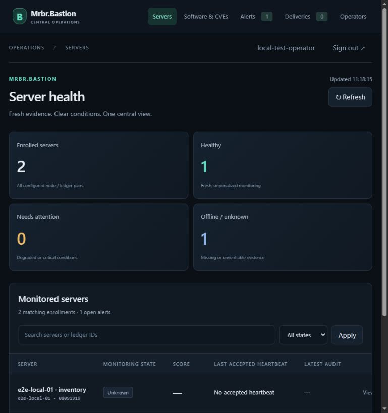

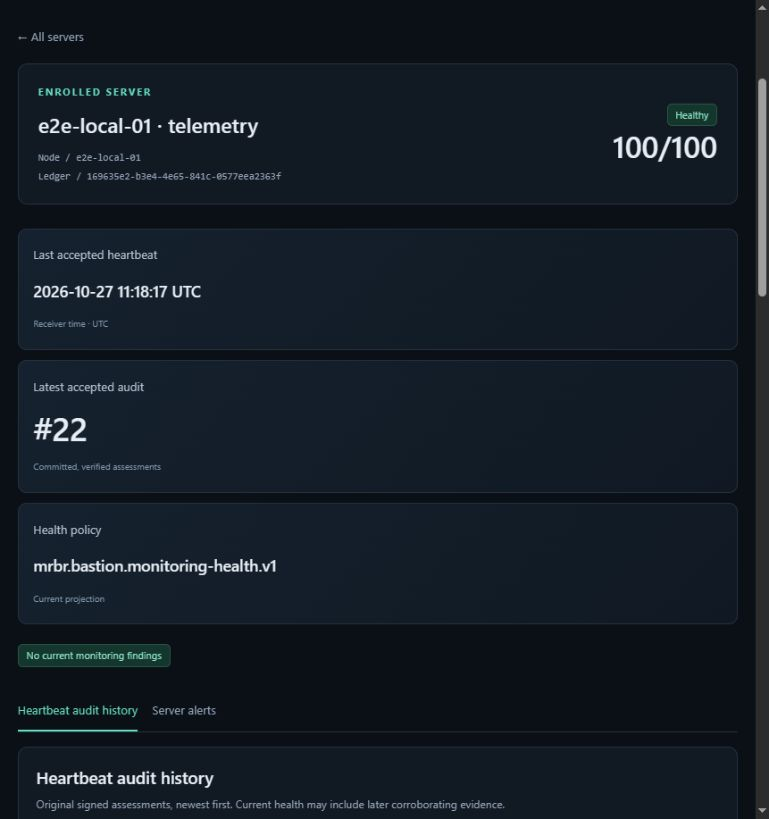

The browser opened the telemetry details and read both new audit rows. An attempted **View evidence** click coincided with the timed receiver stop and could not load its dialog; no successful dialog inspection is claimed for this run. The history endpoint itself verifies retained audit evidence on read. Section 14 records the earlier successful evidence-dialog inspection.

### Probe, durable delivery and final shutdown

During this run, a supporting shell launched the existing test probe with `--io` and this exact file argument:

```text
E:\Dev\source\Mrbr.Bastion\tmp\e2e-local-20261027\probes\bastion-feedback-probe-6.txt
```

The probe exited **0**. Its PID **16008** and observed `pwsh` parent PID **15940** both had correlated collector-local lifetime IDs. The retained telemetry includes the probe's **start and exit**, plus **two open, two write, three read and one close observations** naming the probe file. Its file observations retain the same historical parent context. This demonstrates that another process accessing the deployment directory remains observable; it does not prove every source operation had a resolved name or that the reported parent was the causal caller.

The inventory source independently retained a signed process-stop record with the probe's parent context. Metadata enrichment for this very short-lived process was unavailable and was explicitly recorded as **ProcessEnrichmentUnavailable**; no product/version or CVE match is claimed for it.

A temporary normal-user receiver and the same supporting **send-only** commands from Section 14 settled the last **6 telemetry** and **1,024 inventory** blocks, with **0 transient failures**. These shell operations followed the GUI run and did not start ETW. Both updated agents then reopened their outboxes with `--inspect`, exiting **0** after verifying the full retained chains and every stored receipt signature.

| Final verification | Telemetry | Inventory |
| --- | ---: | ---: |
| Retained / centrally accepted blocks | 7,080 | 14,569 |
| Matching signed block bodies and hashes | 7,080 | 14,569 |
| Matching verified receipt contents | 7,080 | 14,569 |
| Pending delivery blocks | **0** | **0** |
| Local / central tips match | Yes | Yes |
| SQLite quick check | `ok` | `ok` |

The central database also returned `ok`. Comparisons normalized JSON property-name casing and preserved every value, payload byte and signature. Aggregate evidence is saved locally in the ignored `tmp/e2e-local-20261027/feedback-tuned-results.json` file.

Final read-only shutdown checks at **11:33:30 UTC** found **0 port-7447 listeners**, **0 control-panel child processes**, and **0 active Mrbr.Bastion ETW sessions**. The supporting receiver logged graceful application shutdown. The configuration windows can remain open with their components stopped.

At **12:16:30 UTC**, the user restored the Administrator configuration window, pressed **Ctrl+3**, then **Ctrl+Shift+F12**. The resulting full-window screenshot confirms the loaded **feedback-tuned.bastion.local.json** profile, managed-process filtering enabled, and **Receiver, Collector and Inventory all Stopped**. Queue and batch properties are below the visible grid rows; scroll the PropertyGrid to inspect the values recorded above. This manual capture replaces the minimized title-bar images.

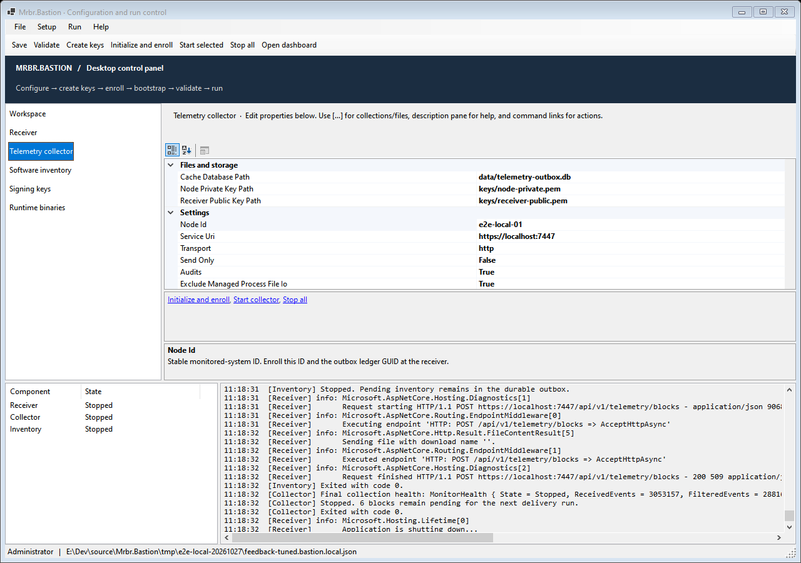

### Follow-up fixes and practical limits

Final inspection found one inventory enrichment item still pending when the timed run stopped. Its signed **ProcessEnrichmentStoppedWithPendingWork** coverage record was preserved. The enrichment worker has since been corrected to stop its producer and drain already accepted queued/in-flight observations through enrichment and durable publication. A deterministic regression test pauses in-flight enrichment, cancels the source, then confirms that every accepted observation is published. This correction was tested after the live run; it is not represented as a second live run with no inventory shutdown gap.

The automatic control-panel PNGs from the tuned run rendered only the title bar because the window was minimized. They were excluded from this guide. A capture guard has since been added so minimized captures report that the window must be restored. Keep the panel restored while using the browser; it can be behind another window. **Ctrl+Shift+F12** captures the restored application with its current settings and component state.

The final Release solution build succeeded with **0 warnings and 0 errors**. The complete core suite passed **363 tests**, with **3 opt-in skips**; the WinForms suite passed **5 tests**. The added inventory-shutdown and minimized-capture corrections were built after the successful telemetry run. The existing Administrator window continues using its already-loaded UI until it is closed and rebuilt/restarted.

This result establishes loss-free telemetry collection for the recorded **90-second, explicitly tuned same-host workload**. Default queue/batch settings did not pass this workload, and the result does not establish unlimited or sustained production capacity. NVD, notification delivery and gRPC remain outside this HTTP-over-HTTPS test's scope.

The isolated telemetry outbox retains all earlier attempts: **489,248,712 payload bytes**, leaving **47,622,200 bytes** under its **536,870,912-byte** limit at final verification. Ongoing monitoring should use a separately provisioned deployment directory and enrolled ledger, with a suitable retention/capacity plan. Existing evidence was not purged, and settling blocks does not recover events lost in earlier attempts.

## 16. Configure cache retention and maintain archive history

**Expected/manual:** these are general operating instructions. The initial retention implementation was verified with isolated signed ledgers, process-crash recovery tests and WinForms tests. Section 17 records the subsequent live ETW/UI verification and actual screenshots. The original feedback-test databases, profiles and keys were left unchanged.

Close the old, stopped configuration windows before rebuilding and reopening the updated application. Upgrade both agents along with the control panel before enabling archiving. Existing profiles load with retention **disabled**. Keep the existing database paths, node keys and enrollments when continuing a deployment.

| Action | Mouse/keyboard input | Result |
| --- | --- | --- |
| Stop managed components | Choose **Run → Stop all**, or press **Ctrl+Shift+F5**; wait until all states read **Stopped**. | Storage maintenance can acquire each outbox's exclusive writer lock. Stop separately launched agents too. |
| Configure telemetry | Press **Ctrl+3**. Set **Maximum Stored Payload Bytes**, then left-click the expand arrow beside **Retention**. | The PropertyGrid shows the resident capacity and nested archive policy. |
| Configure inventory | Press **Ctrl+4** and expand its independent **Retention** object. | Inventory uses its own outbox, archive catalog and policy. |
| Set archive storage | Select **Archive Directory**, edit the value, then press **Enter**. For example, enter `E:\BastionArchives`. | Each ledger uses its own ledger-ID subfolder. A relative root resolves against the database folder. An empty value reuses its recorded location, or initially defaults to `<database>.archives`. |
| Set limits | Edit the recent window, minimum age, interval, segment bounds and archive quota. Select a field to read its description; press **F1** for contextual help. | Limits are validated before launch. See defaults below. |
| Enable and save | Set **Retention → Enabled** to `True`; press **Ctrl+S**, then choose **Validate** and **Export**. | The profile saves both policies. Export writes `server.json`, `inventory.json` and `collector-retention.local.json` without session secrets. **Start selected** also exports them. |
| Check existing history | Select the desired collector/inventory components in **Workspace**, then choose **Storage → Verify cache history**. | The log reports combined resident/archive status after full signature and chain verification. No pruning occurs. |
| Archive eligible evidence | With components stopped, choose **Storage → Archive settled caches**, or the matching collector/inventory PropertyGrid command. | The current profile is saved first. One bounded pass runs on enabled, selected caches; the log reports the result and archive directory. Repeat for a larger backlog. |
| Reclaim physical database space | With components stopped, choose **Storage → Compact caches**. | Full verification, WAL checkpoint and SQLite compaction return reusable pages to the filesystem. Allow working space and time for large databases. |
| Resume monitoring | Left-click **Start selected**. | Agents deliver normally and periodically archive eligible settled history. Capacity pressure also attempts a pass before rejecting an append. |

Default policy values are **128 newest blocks resident**, **60 seconds minimum age**, a **30-second interval**, **1,024 blocks / 16 MiB payload / 64 MiB file per segment**, **8 segments per pass**, and a **10 GiB archive-file quota per ledger**. These are independent limits. The default resident payload capacity is **512 MiB** per agent. Choose enough capacity for pending deliveries, the protected recent window and peak ingest rate; database overhead needs additional disk space.

Retention only archives a contiguous prefix with valid signed settlement receipts. It stops at the first unsettled block even when later blocks have receipts. The newest window and both the signed block/receipt minimum ages are protected. Each archive preserves the exact original block and receipt bytes, with a signed manifest and digest linked to the previous archive. The file is flushed and verified before an atomic SQLite catalog update and deletion of those exact settled rows.

Archives remain part of verified ledger history and are **never automatically expired**. Retention reduces resident cache pressure; it does not make total history storage finite. Reaching a quota or running out of disk reports failure and preserves existing evidence. Automatic pruning lets SQLite reuse pages; use compaction when physical file shrinkage is needed. Signed heartbeat totals include archived payload and continue with the same ledger identity and chain tip.

For backup or relocation, stop the hosts and preserve the database **together with all referenced archives**, trusted public keys and external checkpoints. Protect signing keys separately. A database-only backup after pruning is incomplete. Configure a new archive root explicitly after copying its complete ledger subfolder and verify before removing the old copy. A crash can leave an unreferenced file; the operator tool reports these files and does not silently adopt or delete them.

`Mrbr.Bastion.Cache.Tool` provides stopped-host **status**, **verify**, **retain** and **compact** commands plus **verify-archive** using public keys only. Copy and edit [cache-maintenance.example.json](config/cache-maintenance.example.json) for that tool. Full policy, command examples, archive format and backup guidance are in [CACHE-RETENTION.md](CACHE-RETENTION.md).

**Automated results:** the complete Release core suite passed **383 tests**, with **3 opt-in skips**; the WinForms suite passed **6 tests**. New coverage includes unsettled gaps, age/recent protection, quota and storage failure, missing/tampered history, exact receipt binding, rejected unsafe schema triggers, disabled retention over existing archives, older trusted checkpoints, portable archive verification, compaction, inventory payloads and signed heartbeat continuity. Child processes were killed after archive flush, before prune commit and after commit; reopening retained either the original resident evidence or the complete verified archive and continued the same ledger. A concurrent test confirmed appends and heartbeat snapshots can proceed while an archive is prepared.

These checks establish the implemented safety and recovery behavior on isolated fixtures. Central ingestion, heartbeat, alert and notification stores retain their existing history and capacity rules; this milestone adds retention to the two agent outboxes.

## 17. Retention-enabled end-to-end verification

Recorded on **27 October 2026**, with times below in **UTC**. This test used a separate deployment:

```text
E:\Dev\source\Mrbr.Bastion\tmp\retention-e2e-20261027
```

The existing `e2e-local-20261027` deployment and its keys, ledgers, profiles and research documents were not modified. Test data, credentials, archives and detailed result files remain under ignored `tmp/`; the selected application/browser screenshots are copied into this guide's image directory.

### Setup, inputs and policy

**Supporting setup:** the test profile JSON was prepared on disk with the values below and opened using the configuration app's `--profile` argument. This was not a manual entry of every PropertyGrid field. The configuration app itself created the signing pairs, initialized/enrolled both outboxes, saved/exported runtime settings and launched the components.

| Setting | Test value |
| --- | --- |
| Node ID | `retention-e2e-01` |
| Receiver / dashboard address | `https://localhost:7547` / `https://localhost:7547/dashboard` |
| Telemetry ledger | `42355566-b793-485f-ae1a-5fddca1ce966` |
| Inventory ledger | `85847013-63d4-491e-9fb5-87b1b67f2177` |
| Agent outboxes | `data/telemetry-outbox.db`, `data/inventory-outbox.db` |
| Fresh signing pairs | `keys/node-private.pem` / `keys/node-public.pem`; `keys/receiver-private.pem` / `keys/receiver-public.pem` |
| HTTPS | Existing trusted current-user ASP.NET Core development certificate, checked before the run. Signing PEMs are separate. |
| Operator | `retention-test-operator`; the user entered a private temporary password directly. It was not sent in chat or saved in a profile. |
| Retention, both agents | Enabled; archive root `archives`, relative to the database folder; newest **4** blocks resident; minimum age **0 seconds**; interval **5 seconds** |
| Segment/pass bounds | **64 blocks**, **16 MiB payload**, **64 MiB file**, **8 segments per pass** |
| Archive quota / resident capacity | **2 GiB archive-file quota per ledger** / **512 MiB resident payload per agent** |
| Collector | Managed-process file-I/O filtering enabled; **1,000 events per batch**, **1,000 ms flush**, **64 MB ETW buffers** |
| First / recovery queue | **32,768** / **131,072** events |
| Inventory | Process and installed-application baseline; live inventory process ETW disabled; 300-second baseline interval; no crawlers |
| External integrations | Notifications and live NVD intelligence disabled for this test; transport was HTTP over HTTPS. |

The short interval, zero minimum age, small segments and recent window deliberately make archiving visible in a bounded test. These are test choices, not recommended universal production settings. Each ledger uses its own subfolder beneath `data/archives`.

| Action | Exact input / interaction | Observed result |
| --- | --- | --- |
| Create fresh keys | **Ctrl+Shift+K**, equivalent to **Setup → Create keys** | Two new signing pairs were created, with public fingerprints logged. Existing test keys were not reused. |
| Initialize and enroll | **Ctrl+Shift+I**, equivalent to **Setup → Initialize and enroll** | Two distinct ledgers were created and enrolled at sequence zero. Independent verification confirmed both initial checkpoints. |
| Save and export | **Ctrl+S**, then **Ctrl+E** | `online.bastion.local.json` and the three runtime JSON files were saved without session secrets. |
| Bootstrap and elevate | User selected **Setup → Create administrator**, entered the account/password, then **Help → Restart elevated** and approved Windows | The replacement window's footer showed **Administrator**. |
| Inspect and start | User pressed **Ctrl+3**, left-clicked the **Retention** expand arrow, then **Start selected** | Receiver, collector and inventory started. The 90-second timer saved midpoint/final application PNGs and stopped all three gracefully. |
| Verify and archive a stopped cache | User pressed **Ctrl+Shift+V**, waited, then **Ctrl+Shift+A**, waited, then **Ctrl+Shift+F12** | Both histories verified. One new segment per ledger archived eligible settled rows; pending evidence remained. |
| Run recovery | User pressed **Ctrl+O**, entered `E:\Dev\source\Mrbr.Bastion\tmp\retention-e2e-20261027\recovery.bastion.local.json`, then **Start selected** | The same enrolled ledgers resumed for 90 seconds with the larger queue and the same retention policy. |
| Drain the remaining tail | A standard-user instance opened `drain.bastion.local.json`; automation pressed **Ctrl+Shift+F6** | Collector **Send Only** was true; inventory discovery sources were disabled for this delivery-only phase. Existing pending blocks were sent without ETW. No new inventory blocks were added. |
| Stop and compact | **Ctrl+Shift+F5**, wait for all **Stopped**, then **Ctrl+Shift+C**, then **Ctrl+Shift+F12** | Histories verified, caches compacted and results captured. The commands enforce the same stopped-host requirements as their Storage menu items. |
| Inspect the dashboard | Receiver-only `dashboard.bastion.local.json`, duration **0**; **Ctrl+Shift+F6**; user opened a fresh tab and signed in | Receiver stayed available without a countdown. Automation left-clicked the telemetry enrollment, pressed **End** to view the history, then left-clicked **View evidence** for audit #6 and used the mouse wheel inside its JSON pane. |

The Windows capture helper continued returning `FrameArrived timed out` and could not control the elevated window. The user operated the elevated controls; normal-user commands used the computer-use keyboard interface. Native **Save screenshot** / timed captures produced the WinForms images, and browser capture produced the dashboard images. These are actual application views, visually checked. Keyboard shortcuts were added to the existing setup/start/storage commands so those functions remain accessible without mouse automation.

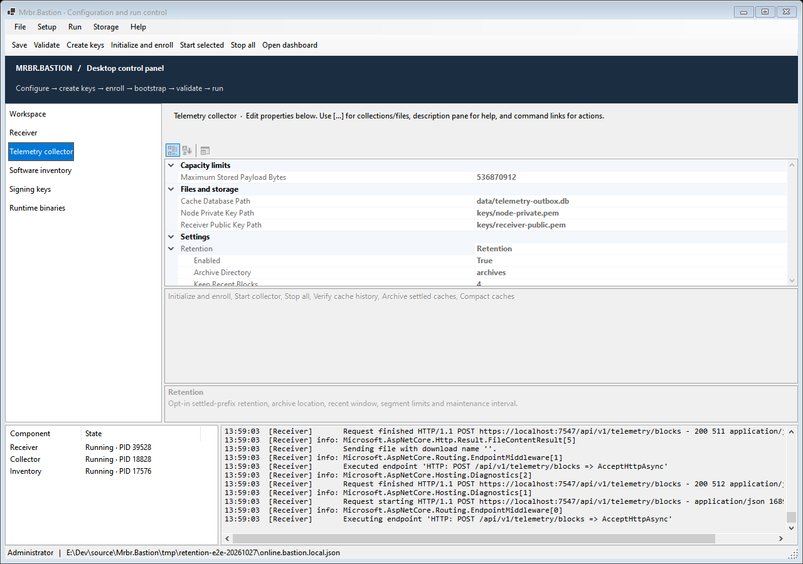

### First run and the pending-block preservation check

The first timed stop was requested at **13:59:48 UTC**; all components had exited with code **0** by **13:59:52 UTC**. Final collector counters were **1,332,738 received**, **1,163,765 intentionally filtered**, **165,423 persisted events in 168 blocks**, **3,550 queue drops**, **0 source-reported ETW losses**, and **0 final accepted-but-unpersisted events**. The queue drops are a failed capture-capacity result and remain part of the record.

Audits #1 and #2 were Healthy, 100/100. Audit **#3** retained **EventsLost** and was Degraded, 75/100. Every audit's local cache outcome was **Verified**. The signed evidence distinguishes collection loss from archive integrity.

The stopped ledgers supplied a real mixed settled/pending state. No synthetic block or receipt was injected for this check. The GUI archive pass produced:

| Frozen maintenance check | Telemetry | Inventory |
| --- | ---: | ---: |
| Logical block count / tip before and after | 168 | 970 |
| Pending before and after | **68 → 68** | **507 → 507** |
| Archived before and after | **98 → 100** | **453 → 463** |
| Resident before and after | 70 → 68 | 517 → 507 |
| New segments / newly archived blocks | 1 / 2 | 1 / 10 |
| Existing raw block bodies preserved | 168 / 168 | 970 / 970 |
| Existing stored receipt bytes preserved | All | All |
| Logical tip, hash and stored-payload total | Unchanged | Unchanged |

An independent verifier reopened the complete chains, checked signatures, receipts, archive manifests/digests and central copies, and verified the earlier externally saved checkpoints. The frozen comparison checked the original local JSON bytes as well as signed contents. All **575 pending bodies** remained resident and byte for byte unchanged, and all **three original signed audit envelopes** remained unchanged. The earliest pending block stopped each archived prefix. This live check covers pending suffixes; the automated retention tests additionally cover an unsettled gap followed by later settled receipts.

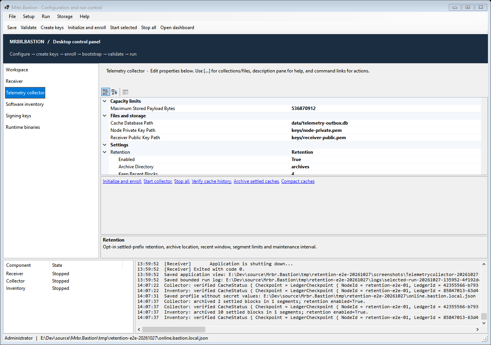

### Recovery and continuing signed audit history

The user opened the separate recovery profile and ran another 90-second collection. All three components exited with code **0** by **14:10:58 UTC**. Its final collector counters were:

| Recovery counter | Value |
| --- | ---: |
| Received observations | 2,811,637 |
| Intentionally filtered observations | 2,608,312 |
| Persisted events / new telemetry blocks | **203,325 / 208** |
| Queue drops / source-reported ETW losses | **0 / 0** |
| Final accepted but unpersisted events | **0** |

All **68 original pending telemetry blocks** and **507 original pending inventory blocks** were now settled and archived. Their original bodies remained unchanged. Telemetry continued to tip **376**, inventory to **2,130**, without changing ledger identities or enrollment. The timed stop left a new tail of **52 telemetry** and **810 inventory** blocks pending for the delivery-only phase.

Audits **#4–#6** continued the original signed result chain, and all were Healthy, 100/100 at acceptance with verified cache snapshots. #4 recorded **CollectorRestarted**. Their **LocalTailAwaitingIngestion** observations described delivery lag. Audit #3's original loss finding was preserved. The historical queue/source counters were not rewritten to make the first run appear loss-free.

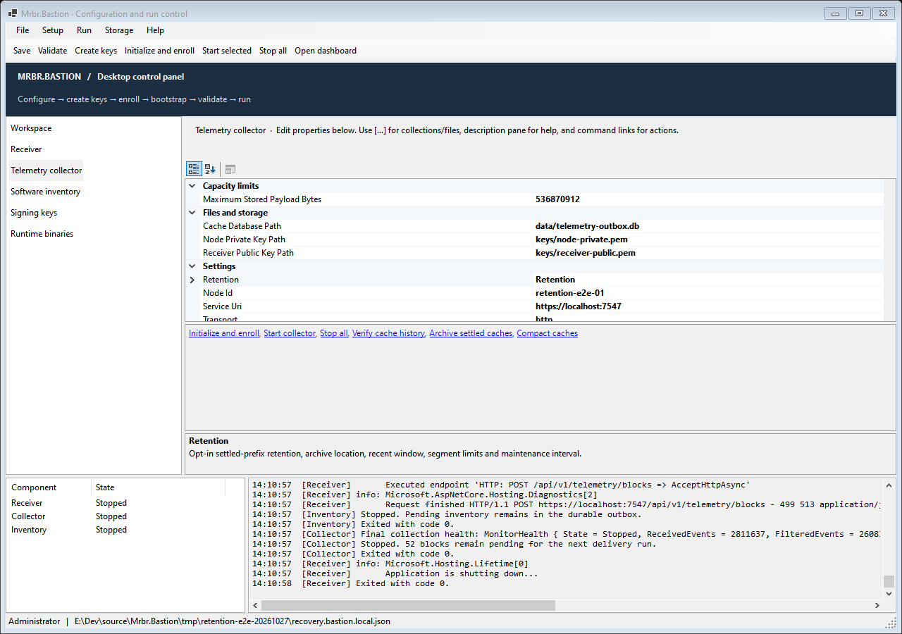

The recovery result establishes the recorded bounded workload with the larger queue. It does not establish indefinite throughput, attribute every capacity difference to queue size, or recover events dropped in the first run.

### Final delivery, archive verification and compaction

The standard-user delivery profile used the same keys, enrollment, database paths and retention policy. With ETW stopped, collector send-only and the inventory delivery worker drained the tail. Read-only checks confirmed zero pending in both outboxes at **14:15:21 UTC**. **Stop all** completed at approximately **14:15:29 UTC**. Inventory's generic shutdown log says that pending inventory remains in the durable outbox; the verified count in this run was **zero**.

| Final verified state | Telemetry | Inventory |
| --- | ---: | ---: |
| Logical / centrally accepted blocks | **376** | **2,130** |
| Pending delivery blocks | **0** | **0** |
| Archived / resident blocks | **372 / 4** | **2,126 / 4** |
| Signed archive segments | 67 | 175 |
| Total retained logical payload bytes | 282,348,234 | 1,629,221 |
| Resident payload bytes | 1,866,206 | 2,560 |
| Archive file bytes, including framing/proofs | 374,482,188 | 4,880,526 |
| SQLite database bytes before compaction | 116,563,968 | 2,981,888 |
| SQLite database bytes after compaction | **2,613,248** | **249,856** |
| Local/central signed contents and receipts | Match | Match |
| Local SQLite quick check | `ok` | `ok` |

The central ingestion and audit databases also returned `ok`. All **2,506 blocks**, **242 archive segments** and **six signed audits** passed full verification. Central comparisons used canonical signed contents/signatures; original local block/receipt byte hashes were separately preserved across archiving and compaction. The frozen pre/post-compaction comparison confirmed unchanged logical checkpoints, payload totals, bodies, receipts, archive catalog and audits. Archive files remain additional required storage; compaction did not expire them.

The actual `Mrbr.Bastion.Cache.Tool verify-archive` executable also verified one segment from each ledger using only `node-public.pem` and `receiver-public.pem` (with `--inventory` for inventory), returning exit code **0** for both. Full-history verification covered every segment through the cache/archive library.

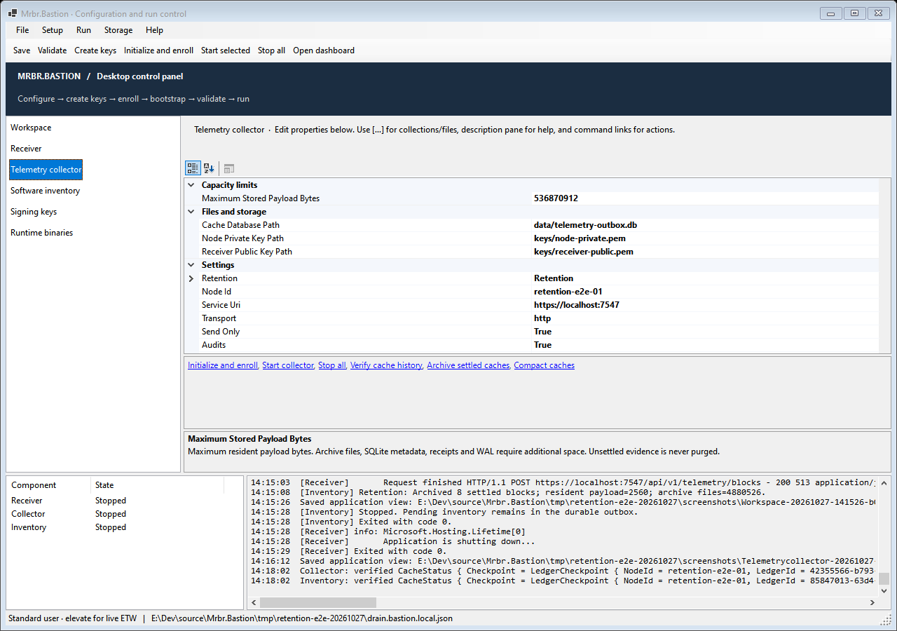

### Dashboard history after receiver restart

The first sign-in attempt overlapped the timed receiver stop and returned **site cannot be reached**. For the final inspection, a receiver-only profile used duration **0** and kept both agents stopped. The user opened a fresh working browser tab and signed in directly with the private operator password.

The dashboard displayed both enrollments and telemetry's latest audit **#6** after restart. Its current state was **Offline, 0/100**, correctly reflecting the intentionally stopped collector and elapsed heartbeat freshness threshold. Inventory remained **Unknown** because it has no collector heartbeat audit. These current projections do not replace the original signed assessments.

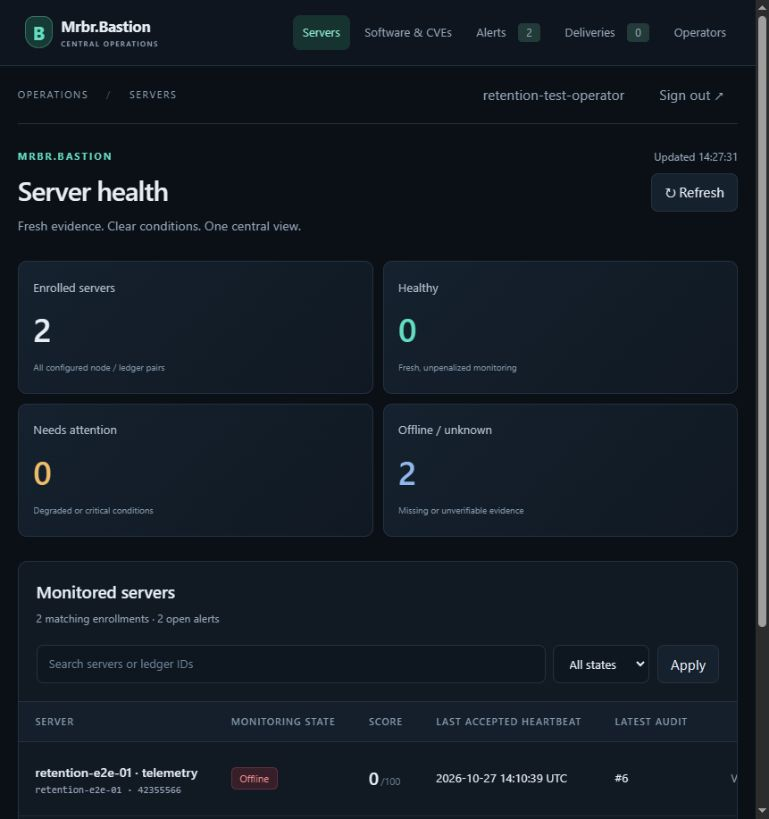

The telemetry history showed **all six audits**, with the same acceptance times and findings verified independently. Audit #3 still showed **New events lost**. #4 still showed **Collector restarted**, followed by the two later verified recovery snapshots. The historical pending counts are the counts at sampling, not the final delivered counts above.

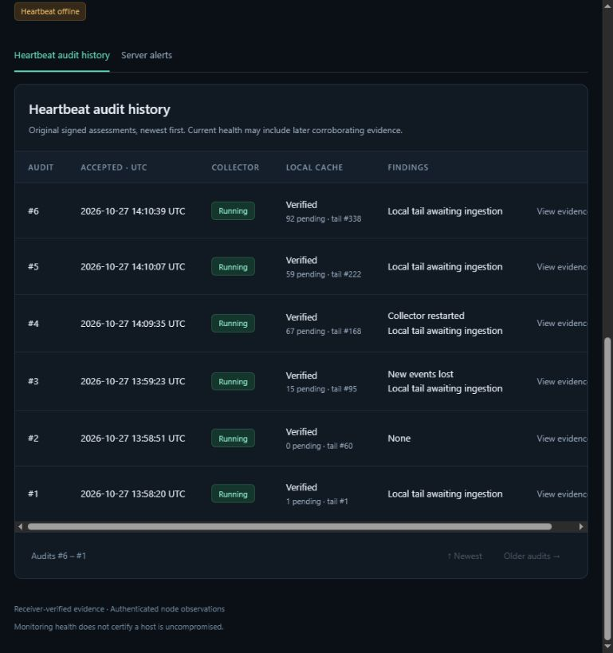

**View evidence** for audit #6 opened successfully after archiving, compaction and receiver restart. It returned the signed request, challenge, response and original assessment, with signature/binding verification on read.

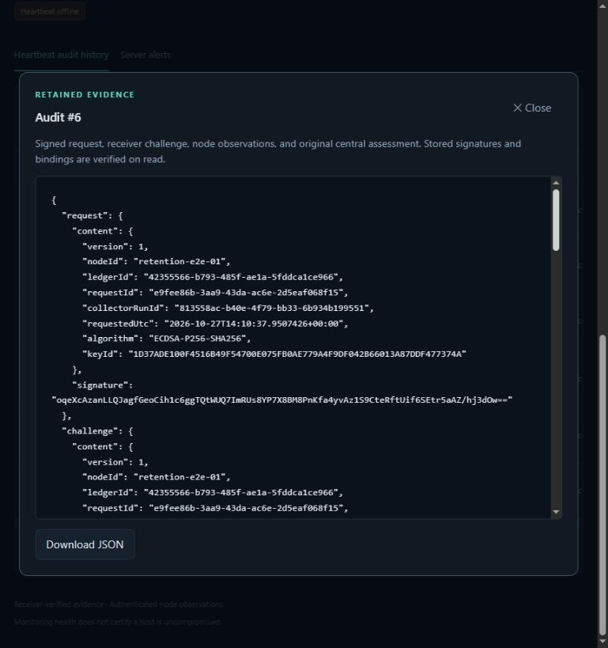

Its signed response retained **Verified**, logical tip **338**, **92 pending blocks**, and **260,253,812 stored payload bytes** at **14:10:39 UTC**. The response also had 381 accepted but not yet persisted events in flight at sampling; the recovery run's final drain subsequently reached zero unpersisted events. None of those historical values was replaced with the later zero-pending state.

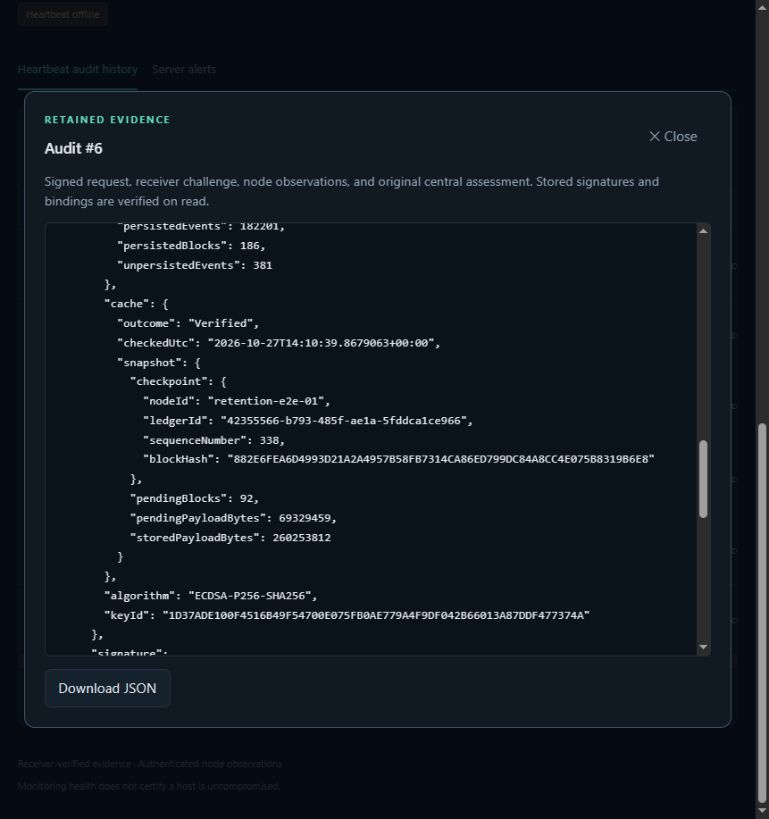

### Evidence files and scope

Detailed local records include `initial-results.json`, `online-before-maintenance-results.json`, `after-maintenance-results.json`, `recovery-results.json`, `drained-results.json`, `compacted-results.json`, their comparison files, public-key CLI results and pre/post-compaction file sizes under the isolated deployment folder. They contain verification metadata; the databases/archives contain the original monitored evidence and remain ignored. The two bounded-run logs are limited by the control panel's bounded log buffer; the independent verification reports supply the complete ledger comparisons.

This test establishes pending-block preservation, subsequent settlement, archive verification, retained audit continuity, GUI maintenance, receiver restart and dashboard evidence access for this isolated deployment. The initial queue overflow remains an observed capacity limitation. Long soak/fleet tests, physical power-loss durability, actual archive-storage failure, live NVD, external notification destinations and gRPC were not exercised in this GUI run. Relevant crash, quota, tampering and unsettled-gap cases have separate automated coverage.

### Final shutdown and validation

The receiver-only control panel was restored before capture. **Ctrl+Shift+F5** requested graceful shutdown; the receiver logged exit code **0** at **14:43:45 UTC**. Read-only checks at **14:43:56–14:43:58 UTC** confirmed **0 port-7547 listeners**, the receiver process had exited, both outboxes still had **0 pending blocks**, and the signed audit count remained **6**. The configuration panel showed **Receiver, Collector and Inventory all Stopped** and was left open.

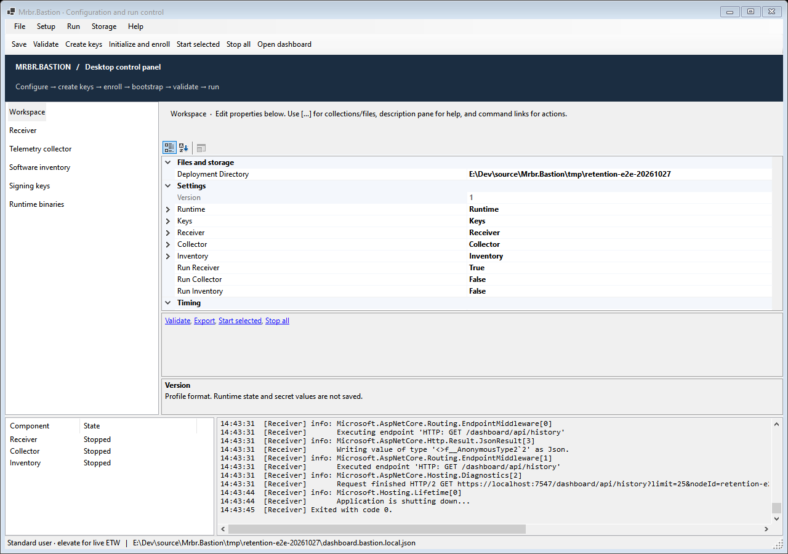

The post-walkthrough WinForms regression suite passed **6/6** tests. The complete Release solution build, including the new documentation entries, succeeded with **0 warnings and 0 errors**. The earlier core retention baseline remains **383 passed / 3 opt-in skips**; this walkthrough added keyboard shortcuts to existing UI commands and documentation, with no change to the retention protocol. Documentation links and the nine new screenshot files were checked. No commit, remote or GitHub publication was created.
