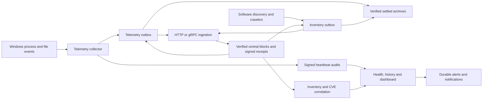

# Mrbr.Bastion: functionality, roadmap and MVP assessment

Assessment date: **27 October 2026**. This is an engineering assessment of the current source, tests and recorded local runs. Proposed work below is a recommendation, not an implemented feature or a commitment to deliver it.

**There is enough functionality for a public, source-based developer MVP.** It demonstrates a complete monitoring and evidence pipeline that people can build, evaluate and adapt. Publish it as an early development project with its supported setup, test evidence and limitations. An unattended production deployment needs further operational work and validation.

## Purpose and boundaries

Mrbr.Bastion records Windows process/file activity and software observations, preserves signed evidence through delivery and retention, and gives operators a central view of monitoring health and potential software exposure. Parent context supplies another investigation signal when an unexpected process appears.

A monitoring-health score describes the monitoring pipeline. A valid signature identifies a reporting key. Neither certifies that a machine is uncompromised, that every event was captured, or that a reported parent was the causal launcher. CVE correlation identifies potential applicability from available evidence; it does not prove exploitation or guarantee that unmatched software is safe.

Contracts, collection, storage, cryptography, transport, ingestion, auditing, software correlation, authentication and presentation have separate projects. The [README project table](README.md#project-boundaries) lists those boundaries. The WinForms app configures and launches the local components; the receiver hosts the web dashboard.

## Necessity continuum

| Rating | Meaning | Consequence |
| --- | --- | --- |
| **1 — Core requirement** | Essential to the stated monitoring/evidence purpose. | A broken invariant blocks a release of that capability. Most are implemented below. |
| **2 — Must have** | Needed before a stated deployment stage can be operated responsibly. | Complete it before that stage; a production requirement need not block a clearly labelled source demonstration. |
| **3 — Nice to have** | Improves usability, investigation or administration without completing a missing safety invariant. | Prioritise using operator demand and measurable benefit. |
| **4 — Edge case / conditional** | Needed for a particular environment, scale or threat model. | Defer until applicable; promote it to a must have when that condition applies. |

These ratings express necessity, not implementation effort or a security certification. “Implemented” means code exists with the evidence described; it does not mean every deployment scenario has been validated.

## Implemented functionality

| Area | Implemented behaviour | Rating and practical limit |
| --- | --- | --- |
| Windows telemetry | Kernel ETW process lifecycle and file open/read/write/close/delete/rename observations; batching, filtering, loss counters and graceful draining. | **1.** Live capture requires Administrator. Operation observations do not establish successful completion. |
| Parent/child context | Collector-local process lifetimes distinguish PID reuse; child observations retain known historical parent identity. Unknown or ambiguous context remains unknown. | **1.** Investigation evidence; no exploit classifier or automatic process blocking. |
| Durable agent evidence | Two independent SQLite outboxes; canonical signed blocks, predecessor hashes, atomic commits, startup verification and explicit capacity failure. | **1.** Payloads are not encrypted by the application. Accepted work not yet committed can be lost on abrupt failure. |
| Telemetry transport | HTTP/JSON and gRPC delivery over HTTPS, bounded requests, retry handling and receipt verification. | **1.** Normal TLS validation and explicit signing trust are required. This local retention run used HTTP over HTTPS. |
| Central ingestion | Explicit node/ledger enrollment, block/payload verification, durable contiguous ingestion and idempotent signed settlement receipts bound to the exact block. | **1.** SQLite storage is finite; central history is not automatically archived or expired. |
| Heartbeat audits | Signed request/challenge/response/assessment flow, expiring nonces, central anchors, linked assessment history and authenticated collection/cache counters. | **1.** The telemetry collector emits these audits. Inventory has a separate ledger and does not currently emit its own collector heartbeat. |
| Health and dashboard | Fleet/server views, freshness and health scoring, retained audit history, signed evidence inspection, alerts and authorised operations. | **1.** Health measures monitoring conditions. There is no general telemetry event-search or graphical process-investigation workspace. |
| Alerts and notifications | Durable alert transitions and acknowledgements; leased delivery queue, retries/backoff, failure inspection, SMTP and HTTPS webhooks with optional HMAC signing. | **1** for operational alerting. Ambiguous delivery can cause duplicates; consumers must use delivery identities for deduplication. External mail providers were not exercised in this retention test. |
| Software inventory | Running/installed software observations, optional live process context, file hashes and PE metadata, bounded file/archive inspection, resumable crawler checkpoints and coverage records. | **1** for the software-exposure capability. Inaccessible, short-lived or incomplete observations retain coverage limitations. Discovered code is not executed. |
| CVE exposure correlation | Reviewed software-to-CPE mappings, NVD integration/cache, applicability/version evaluation, freshness/coverage states, finding history and exposure alerts. | **1** for that capability. Unmapped or insufficient evidence remains unknown. Live NVD access was disabled during this test. |
| Operator access | Named accounts; Viewer, Operator, Analyst and Administrator permissions; salted password hashing, lockouts, durable session state, revocation, CSRF checks, security events and offline administrator recovery. | **1.** No MFA or federated sign-in. Operator/security events are durable database records; they are not the signed heartbeat evidence chain. |
| Configuration and administration | WinForms PropertyGrid, saved profiles, secret-free runtime export, contextual help, keyboard/menu/verb commands, PEM pair creation/verification, enrollment, administrator bootstrap and local process control. | **1** for the current setup workflow. It does not install services or administer remote machines. Session secrets need provisioning again after loading. |
| Retention and archives | Independent policies for both outboxes; verified settled-prefix archiving, pending-gap protection, signed linked manifests, original block/receipt preservation, archive quotas, full-history verification and compaction. Dedicated public-key archive verification CLI. | **1** for sustained monitoring. Archives remain required evidence and never expire automatically; total disk demand still grows. |
| Recovery and test infrastructure | Real signatures/SQLite, tamper/retry/authorisation tests, child-process crash recovery and isolated GUI runs with screenshots. | **1.** Short local runs establish specific behaviours, not a fleet-scale endurance result. |
| Repository foundation | MIT licence, README, contribution/security guidance, examples, ignore rules and a Windows CI workflow. Research under `docs/`, deployment state, credentials and archives are ignored. | **2** for public distribution. A configured workflow is not evidence that it has passed on GitHub. |

Entry points are the [configuration guide](CONFIGURATION-GUIDE.md), [desktop reference](Mrbr.Bastion.Desktop/README.md), [retention guide](CACHE-RETENTION.md), and [configuration templates](config/).

## Evidence and remaining validation

The [retention end-to-end record](CONFIGURATION-GUIDE.md#17-retention-enabled-end-to-end-verification) uses a fresh deployment, new keys and two newly enrolled ledgers. The configuration app created/enrolled keys and outboxes, launched the components, archived a mixed settled/pending state, delivered the remaining backlog and compacted the caches. The dashboard then displayed the retained assessments after a receiver restart.

| Check | Recorded result |
| --- | --- |
| Frozen maintenance with pending evidence | All **575 pending block bodies** remained byte for byte unchanged; 12 additional settled blocks were archived. Ledger tips and logical byte totals were unchanged. |
| Recovery | All 575 originally pending blocks later received matching signed receipts and were archived. New assessments continued the original audit chain. |
| Final history | **376 telemetry + 2,130 inventory = 2,506 blocks**, fully verified against central copies and receipts; zero pending. **Six signed audits** remained valid. |
| Final archive/resident split | Telemetry: **372 archived / 4 resident**. Inventory: **2,126 archived / 4 resident**. |
| Compaction | Telemetry database: **116,563,968 → 2,613,248 bytes**. Inventory: **2,981,888 → 249,856 bytes**. Evidence and logical checkpoints were unchanged. Archive files are additional storage. |
| Capture capacity | First 90-second run: **3,550 queue drops**, correctly retained in audit #3. Recovery with a 131,072-event queue: **203,325 persisted events**, zero reported queue/source loss and zero final unpersisted events. |
| Automated baseline | Retention implementation: **383 core tests passed**, three opt-in skips; **6 WinForms tests passed**. The guide distinguishes this baseline from the live runs. |

The observed queue drops make performance/capacity validation a concrete remaining requirement. Raising a queue bound absorbs bursts; it does not establish sustainable throughput. Neither run establishes behaviour over days, across a fleet, during disk exhaustion, or after a production service-account migration. gRPC, external notification delivery and live NVD retrieval are implemented/tested in other ways, but are outside this GUI retention run's evidence.

The original assessment used focused pattern/ignore checks and preceded any commit or remote. The subsequent [publication checklist](PUBLICATION-CHECKLIST.md) records the full candidate secret scan, screenshot privacy review, exact SDK choice, clean-checkout verification and outstanding GitHub actions. These are scoped checks, not an independent security assessment. The historical GUI results above have not been relabelled as RC3 runs.

## To do before broader use

These are actionable gaps identified from the current implementation and test results. They are separate from optional scope expansions below.

| ID | Work / current status | Necessity and stage | Completion criterion |
| --- | --- | --- | --- |
| T1 | Prepare the first public source snapshot. Local preparation is tracked in the publication checklist; public push/channel/hosted CI await the final publication decision. | **2 — Must have before public release.** | Review candidate files and screenshots for sensitive data, keep deployment data excluded, perform a clean-checkout build, configure a real private vulnerability channel, and record a successful GitHub CI run. |
| T2 | Developer-preview baseline selected: .NET 11 RC3, exact SDK with roll-forward disabled. | **2 — Must have for a supported release.** The owner explicitly selected a labelled developer preview. | Validate the exact setup and document the RC3 support window. Windows is required for collectors and WinForms; the verified CLI setup is recorded in the publication checklist. A supported production release still needs a maintained platform/toolchain policy. |
| T3 | Establish sustained capacity and failure limits. Short checks exist; endurance evidence is missing. | **2 — Must have for unattended monitoring.** | Run a representative multi-day soak with concurrent inventory/retention/audits, receiver outages, restarts and quota pressure; publish resource/throughput bounds, loss counters and recovery results. Include archive-count/file-handle growth and startup/audit cost. |
| T4 | Add a first-class operational storage/capacity view. Counts/errors are currently available through CLI and local maintenance logs. | **2 — Must have for unattended monitoring.** | Surface resident/archive/WAL/free-space usage, quota proximity, oldest pending age and maintenance failures; alert before collection hits a capacity limit. |
| T5 | Plan central storage retention and archiving. Agent retention is implemented; central stores retain their existing finite limits. | **2 — Must have for sustained central operation.** | Define verifiable archival/retention for ingestion, audits, alerts, security events, notification history and software stores, with explicit recovery and hold/exception behaviour. |
| T6 | Provide consistent backup/restore tooling and a tested recovery runbook. Manual guidance exists. | **2 — Must have before depending on retained evidence.** | Back up related databases and referenced archives consistently, protect keys separately, restore onto another machine/service identity, verify external checkpoints and document recovery limits. |
| T7 | Add unattended hosting and deployment packages. Current launcher manages interactive local children. | **2 — Must have for unattended deployment.** | Install/start/stop/update services with explicit accounts, startup recovery, graceful upgrades, permissions and resource limits; keep the operator UI at ordinary privilege where possible. |
| T8 | Complete key, certificate and enrollment lifecycle administration. Provisioning and trust primitives exist; the complete operational workflow is partial. | **2 — Must have before a managed fleet.** | Rotate signing/TLS keys without losing historical verification; preserve old public trust appropriately, reject retired credentials for new evidence, decommission nodes without deleting history, and report expiry. Test stock-agent configuration across rotation. |
| T9 | Add investigation-oriented telemetry read APIs and views. Raw signed blocks and parent context are retained; a general event timeline/search is missing. | **2 — Must have for an operator investigation MVP.** Source-library MVP can precede it. | Authorised, paginated process/file search with time/node/lifetime filters, parent/child navigation, evidence provenance and export, including coverage gaps. |
| T10 | Harden and document deployment secrets, filesystem protection and session key material. Existing controls cover several parts. | **2 — Must have for a supported deployment.** | Verify service-account ACLs, protected key/secret storage, production certificate setup, cookie-protection key provisioning, restart/restore behaviour and safe diagnostics. Document volume protection for cleartext telemetry. |
| T11 | Record administrative configuration and maintenance changes centrally. Current profiles/logs are local; operator account changes have their own security history. | **2 — Must have where evidence administration must be attributable.** | Retain actor, reason, policy/version, affected ledger and before/after result for enrollment, retention, export, recovery and configuration changes; define offline attribution limits. |
| T12 | Establish release/security maintenance. Guidance exists; no release support matrix or response SLA is published. | **2 — Must have before a supported binary release.** | Independent security review, dependency monitoring, reproducible release validation, release checksums/provenance, third-party notice review and a documented update/vulnerability-response policy. |

The SDK recommendation follows [Microsoft's support policy](https://dotnet.microsoft.com/en-us/platform/support/policy/dotnet-core): prerelease support depends on the release and its support window. The pin in this repository must be evaluated as part of release preparation rather than described as a generally available baseline.

## Additional functionality related to the core purpose

| Capability | Necessity | Why / boundary |
| --- | --- | --- |
| Versioned suspicious parent/child and file-activity rules | **3 — Nice to have** for the current evidence MVP; **2** if marketed as automatic threat detection. | Turn observations into reviewable leads with tunable exceptions, coverage-aware confidence and evidence links. Avoid asserting exploitation from a process relationship alone. |
| Rich process-tree/timeline visualisation | **3 — Nice to have**, after T9. | Makes historical lifetimes and missing lineage easier to investigate; a graph alone does not add collection certainty. |
| Authenticode/package/SBOM identity enrichment | **3 — Nice to have**; **2** where reliable publisher provenance is required. | Improves software identity and mapping decisions. Existing company/version resources and name similarity are not publisher authentication. |
| Analyst dispositions and remediation tracking | **3 — Nice to have.** | Record accepted risk, mapping corrections, ownership, expiry and verified remediation without rewriting original findings. |
| Signed combined evidence bundles | **3 — Nice to have**; **2** for an independently reviewable export requirement. | Package blocks, receipts, manifests, audit proofs and external anchors with a verifier. Existing single-file archive verification remains useful. |
| File integrity baselines and change comparisons | **3 — Nice to have.** | Add a reviewable change signal using observed hashes and trusted baselines; distinguish an approved update from an unknown change. |
| Additional Windows Security/SMB/network sources | **4 — Conditional.** | Required if the scope includes logon attribution, remote access or network activity; existing file ETW does not establish those facts. |
| Current open-handle inspection | **4 — Conditional forensic aid.** | Complements historical file events when an operator needs to know which process currently holds a handle. Bound privileges, cost and coverage; it is not currently implemented. |
| Active response: terminate, quarantine or block | **4 — Scope expansion.** | Requires a separate authorisation, safety and audit design. It is not necessary for the present monitoring/evidence MVP. |

## Additional administrative functionality

| Capability | Necessity | Why / promotion condition |
| --- | --- | --- |
| Agent resource and worker diagnostics | **2 — Must have for unattended operation**, alongside T4. | Expose CPU/memory, queue pressure, source losses, worker lag, archive handles and dependency failures so degradation is actionable. |
| Fleet enrollment/configuration administration | **3 — Nice to have** for a small installation; **2** for a managed fleet. | Replace repeated file edits with attributable enrollment, grouping, policy rollout and status, while preserving explicit trust. |
| Notification test/dry-run, route health and maintenance windows | **3 — Nice to have.** | Validate destinations, reduce planned-maintenance noise and explain delivery failures without erasing alert history. Durable retries already exist. |
| Standard metrics/log export and SIEM integration | **3 — Nice to have**; **2** when an existing operations platform is the required control surface. | Reuse organisational monitoring and alert ownership; redact sensitive paths/credentials deliberately. |
| Configuration diff/history and approved rollback | **3 — Nice to have**; attribution requirements belong in T11. | Make policy changes reviewable. Rollback must not silently rewind ledgers, keys or trusted checkpoints. |
| OIDC/SSO and MFA | **4 — Conditional**, promoted to **2** for organisational identity policy or wider administrative exposure. | Centralise lifecycle and strengthen access. Existing named-user RBAC remains the current local model. |
| mTLS and proxy deployment profiles | **4 — Conditional.** | Add transport-level client identity and controlled edge deployment when required. Signed node blocks and HTTPS already provide their current trust boundaries. |
| High availability, alternate central storage and tenant isolation | **4 — Conditional**, promoted to **2** for large fleets or a hosted multi-tenant service. | Current SQLite composition is not evidence of HA or tenant isolation. |
| Air-gapped intelligence import and offline update packages | **4 — Conditional.** | Support disconnected sites with authenticated provenance and explicit freshness/coverage. |
| Hardware-backed signing, attestation and stronger tamper resistance | **4 — Conditional.** | Relevant to stronger endpoint-compromise threat models. Signed software observations alone are not remote attestation. |
| Cross-platform collection and additional crypto providers | **4 — Conditional.** | Useful only when OS/cryptographic scope expands. Portable contracts do not provide Linux/macOS collection or an implemented post-quantum provider. |

For distributed releases, integrity metadata and a maintained vulnerability-response process are sensible release requirements, consistent with [NIST's Secure Software Development Framework](https://csrc.nist.gov/pubs/sp/800/218/final). This is a planning reference, not a claim of conformance.

## GitHub MVP decision and publication checklist

| Intended use | Assessment |
| --- | --- |
| Public source for developers to inspect, build, learn from or adapt | **Functionally sufficient now**, after the publication checks below. Label the maturity and prerelease prerequisites clearly. |
| Controlled operator/lab evaluation | **Suitable with documented limits and operator oversight.** Use isolated deployment state, monitor capacity, preserve backups and expect manual administration. T9 would substantially improve investigation usability. |
| Supported, unattended production fleet | **Further work required.** Prioritise T3–T8, T10–T12 and representative deployment/security validation. |

Before the first public push:

- [x] Review candidate files and all screenshots for credentials and identifying host evidence; withhold the host inventory image and record reviewed image hashes. Run the final staged/history gate before publication. Ignore rules do not sanitize files or history.
- [ ] Complete clean-checkout and hosted CI evidence, tracked separately in the publication checklist. Local success is separate from a GitHub run.
- [x] Add an explicit early-MVP status, setup, exact RC3 baseline and known limits to the landing page; link the guides and roadmap. Do not advertise zero-loss, intrusion prevention, complete vulnerability coverage or production readiness.
- [ ] Establish the real vulnerability reporting channel described by `SECURITY.md`, and verify that a reporter can use it privately.
- [x] Select a source-only `v0.1.0-preview.1` prerelease. Dependencies are restored separately with their own licenses; binary redistribution remains a future release concern.
- [ ] Create the initial commit/remote and publish only after that concrete snapshot has been reviewed. This assessment does not publish it.

README, licence, contribution/security/support guidance and issue/PR templates are present. A code of conduct can be added when a private enforcement contact and community process are established. These files do not replace operational safety work. See [GitHub's community profile guidance](https://docs.github.com/en/communities/setting-up-your-project-for-healthy-contributions/about-community-profiles-for-public-repositories). Enable/check repository secret protection as part of publication using [GitHub's secret-scanning guidance](https://docs.github.com/en/code-security/how-tos/secure-your-secrets/detect-secret-leaks/enable-secret-scanning); it complements pre-publication review.

## Recommended next milestones

1. **Publish the developer MVP:** complete T1, clarify toolchain/maturity in T2, preserve this test record and obtain a clean-checkout/CI result. No extra monitoring feature is needed merely to make the source useful to others.
2. **Make investigations and capacity visible:** T9, T4 and resource/worker diagnostics, with authorised bounded queries and actionable storage alerts.
3. **Make deployment repeatable:** T7, T8 and T10, including least-privilege service accounts and tested upgrades/rotation.
4. **Make retained evidence recoverable at scale:** T6, T5 and T11, with restore drills, external anchors and administrative attribution.
5. **Qualify an unattended release:** T3 and T12, then select additional detection or enterprise features from measured user needs.
